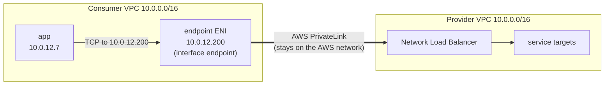
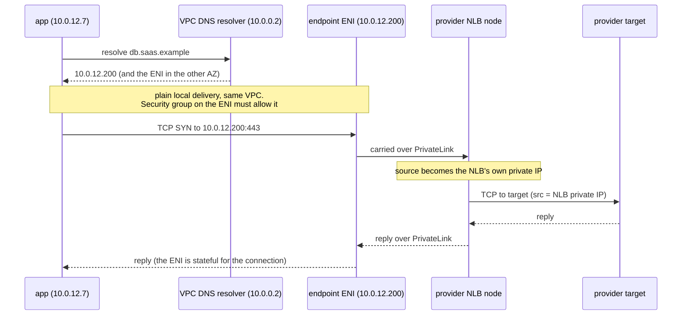
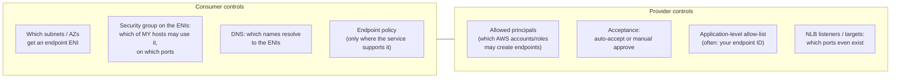

AWS PrivateLink lets a workload in **your** VPC talk to **one service** that lives in somebody else's VPC, often in another AWS account, using private IP addresses from your own subnets. No internet gateway, no NAT, no peering, and no routes between the two networks.

The idea is simple. Almost everything that goes wrong with it in practice is **DNS** or **who-is-allowed-to-connect**, so most of this note is about those two.

Everything here is checked against the AWS PrivateLink, Elastic Load Balancing and Route 53 documentation as of **October 2026**. Links are at the end.

---

## 1. The problem: a service that isn't in your network

You run workloads in private subnets. A provider runs a service you need: a managed database, an internal API owned by another team, a SaaS product. It lives in **their** VPC, in **their** account.

```
   your account                                their account
 ┌───────────────────────────┐             ┌───────────────────────────┐
 │ VPC 10.0.0.0/16           │             │ VPC 10.0.0.0/16  (!)      │
 │                           │             │                           │
 │   app  10.0.12.7          │     ???     │   service  10.0.40.20     │
 │   (private subnet,        │ ──────────► │   (private subnet)        │
 │    no public IP)          │             │                           │
 └───────────────────────────┘             └───────────────────────────┘
```

How do you get a packet from `app` to `service`? There are three classic answers. Two of them are worse than they look.

### 1.1 Over the internet

The provider gives the service a public endpoint. Your app goes out through a NAT gateway, and the provider allow-lists your NAT's public IPs.

```
app ──► NAT gateway ──► internet gateway ──► public endpoint ──► service
         (your public IP)                     (their allow-list)
```

It works, but:

- **The service has to be on the internet.** Its security now rests on an IP allow-list plus whatever authentication it has.
- **Your egress IPs become an identity.** Change NAT gateways and the allow-list breaks.
- **NAT processes every byte, and you pay for each one.** A chatty database connection gets expensive.
- Many compliance regimes say data like this "must not traverse the public internet", and this path is hard to argue around.

### 1.2 Join the networks: VPC peering or a Transit Gateway

Peering (or a Transit Gateway) connects two VPCs at the IP layer. Each side adds a route for the other side's CIDR, and packets flow both ways.

It fails here for three reasons:

**1. The CIDRs must not overlap.** Look at the picture again: both VPCs are `10.0.0.0/16`. A route says "send 10.0.0.0/16 over there", but 10.0.0.0/16 is also *here*. There's no way to express that. Peering is simply refused for overlapping CIDRs, and with a Transit Gateway the routing becomes ambiguous. Between two companies, or two teams that never coordinated, overlap is the normal case: everyone picked 10.0.0.0/16.

```
 your VPC 10.0.0.0/16  ◄──── peering? ────►  their VPC 10.0.0.0/16
                         ✗ overlapping CIDRs:
                           "route 10.0.0.0/16 → peer" is meaningless
```

**2. You connect networks, not a service.** Once routes exist, every host on one side can try every host and port on the other side. You wanted one service on one port. You got a whole network, and now security groups on both sides are the only thing standing between them.

**3. Trust becomes two-way.** The provider can now reach into your VPC as easily as you reach into theirs. A SaaS provider with thousands of customers can't run a peering per customer, and wouldn't want to.

### 1.3 What we actually want

Write the requirements down and the design falls out of them:

| Requirement | Implies |
|---|---|
| Expose **one** service, not a network | Something that terminates *a service*, not a route |
| Work even if CIDRs overlap | No routes between the two VPCs at all |
| Traffic stays on the AWS network | No internet gateway / NAT in the path |
| Consumer can't wander into the provider, provider can't initiate into the consumer | Connections are one-way: consumer → provider only |
| Provider decides who may connect; consumer decides which of its hosts may use it | Two independent access controls |

That's PrivateLink.

---

## 2. The idea: a door, not a bridge

Peering builds a bridge between two cities. PrivateLink puts a **door** in your wall that opens directly into **one room** of the other building.



There are two halves:

**Provider side: the endpoint service.**
The provider puts a **Network Load Balancer** in front of the service and creates an **endpoint service** from it. AWS gives it a name like `com.amazonaws.vpce.<region>.vpce-svc-0123456789abcdef0`. By default nobody can connect; the provider must add **permissions** for specific AWS principals. (A Gateway Load Balancer can also back an endpoint service, but that's for inline appliances like firewalls, a different use case. This note is about the NLB case.)

**Consumer side: the interface endpoint.**
You create an **interface VPC endpoint** that points at that service name. For **each subnet you pick (one per Availability Zone)**, AWS creates an **endpoint network interface (ENI)** in that subnet with a private IP **from your subnet's range**. Your app connects to that IP as if the service were a local host.

The consequences are exactly the requirements from section 1.3:

- **No routes are added anywhere.** The ENI is just a local address in your subnet, and the VPC's local route already covers it. That's why **overlapping CIDRs don't matter**: the two address spaces never meet.
- **Connections are consumer-initiated.** You connect to the ENI. The provider can't open a connection back into your VPC through it. (AWS's docs state this explicitly for AWS services: "The service can't initiate requests to resources through the VPC endpoint." The same model applies to endpoint services in general: the consumer initiates and the provider accepts.)
- **Traffic stays on the AWS network**, never the public internet.
- **The provider sees its own NLB, not you.** See section 3.2.

The endpoint ENIs are **requester-managed**. You can see them in your account, but you can't modify or delete them directly; you manage them through the endpoint. Their IPs don't change for the lifetime of the endpoint.

---

## 3. A packet walk

### 3.1 The happy path



The steps, written out:

1. **DNS.** The app looks up the service's hostname. Something in your VPC's DNS must answer it with the **endpoint ENI IPs**. Section 5 covers where that answer comes from; it's the part that usually breaks.
2. **Local delivery.** The app sends to `10.0.12.200`. That's an address in your own VPC, so the normal local route delivers it. **The security group attached to the endpoint** must allow the app's source on that port.
3. **Across PrivateLink.** AWS carries the connection to the provider's NLB.
4. **Inside the provider.** The NLB forwards to a target. The target sees the **NLB's private IP** as the source.
5. **Reply.** It comes back the same way. Security groups are stateful, so no extra rule is needed for the return traffic.

### 3.2 What the provider actually sees

AWS's NLB documentation is explicit: for traffic arriving through PrivateLink, *"the source IP address of the AWS PrivateLink traffic is always the private IP address of the Network Load Balancer"*. Client IP preservation has no effect on it.

This is why overlapping CIDRs are harmless. The provider never sees `10.0.12.7` as a source, so it never has to route back to your address space.

If the provider *does* need to know who connected, it turns on **Proxy Protocol v2** on the target group. The NLB then prepends a header with the original source and destination addresses and an AWS-specific TLV (type `0xEA`, subtype `0x01`) carrying the **VPC endpoint ID**, e.g. `vpce-0abc123def4567890`. That endpoint ID is how a provider tells customers apart at the network layer, and it's why many providers ask you for it (section 4).

---

## 4. Who controls what

Two independent parties, two independent sets of locks. Both must say yes.



### 4.1 Provider side

- **Allowed principals.** An endpoint service is closed by default. The provider adds the AWS principals (accounts, roles, users) allowed to connect. If you aren't on the list, you can't create an endpoint to it.
- **Acceptance.** The provider chooses whether connection requests are accepted automatically. With manual acceptance, your endpoint sits in `PendingAcceptance` until they approve it. They can also **reject an endpoint later**, even after it's `Available`.
- **Application-level allow-lists.** A SaaS provider that offers one endpoint service to all its customers usually leaves the AWS-level gate open ("any account may create an endpoint") and does the real access control itself: you register your **endpoint ID** in their console against your specific tenant or service. Until you do, your endpoint is `Available` in AWS but the provider resets or refuses the connection. This step is easy to forget, because nothing on the AWS side tells you it's missing.

### 4.2 Consumer side

- **Subnets and AZs.** One subnet per AZ, one ENI each. You can only choose AZs where the provider's endpoint service is available (where their NLB is enabled).
- **The endpoint's security group.** It's attached to the ENIs and is your main control: *which sources in my VPC may use this service, on which ports*. If you don't specify one, the VPC's **default security group** is attached, which is rarely what you want.
- **Endpoint policy.** An IAM resource policy on the endpoint. It only means something where the service supports it. AWS's docs say plainly: *"When you create a VPC endpoint for an endpoint service other than an AWS service, we allow full access to the endpoint."* So for a third-party service, **the security group, not a policy, is your control.**
- **DNS.** Whether names resolve to the ENIs at all, and which names. That's the next section.

---

## 5. DNS: where most PrivateLink problems live

The endpoint gives you IP addresses. Your application uses **hostnames**. Something has to connect the two, and there are three ways to do it.

### 5.1 The endpoint's own DNS names

Every interface endpoint gets AWS-generated names:

```
Regional:  vpce-0abc123def4567890-ab12cd34.vpce-svc-0123456789abcdef0.<region>.vpce.amazonaws.com
Zonal:     vpce-0abc123def4567890-ab12cd34-<region>a.vpce-svc-0123456789abcdef0.<region>.vpce.amazonaws.com
           vpce-0abc123def4567890-ab12cd34-<region>b.vpce-svc-0123456789abcdef0.<region>.vpce.amazonaws.com
```

- The **regional** name returns healthy ENIs across AZs, alternating between them round-robin.
- A **zonal** name returns only that AZ's ENI. Use it if you want to keep traffic inside one AZ.
- These records are **public** DNS: anyone can resolve them. But they return **private** IPs, which are useless outside your VPC. They aren't a secret and don't need to be.

They always work, but nobody wants `vpce-0abc…amazonaws.com` in their application config, and a TLS certificate for the service won't carry that name either. So you almost always want the **service's real hostname** to resolve to the ENIs instead.

### 5.2 Option A: private DNS (provider-managed)

The provider can attach a **private DNS name** to its endpoint service, for example `db.saas.example`, or a wildcard like `*.db.saas.example`. To do that, the provider must **prove they own the domain** by publishing a TXT record AWS gives them. Until verification succeeds, consumers can't use the name.

When you create an endpoint with **private DNS enabled**, and your VPC has both `enableDnsHostnames` and `enableDnsSupport` on, AWS creates a **hidden, AWS-managed private hosted zone** and associates it with your VPC. Inside your VPC, the service's normal hostname now resolves to your ENIs. Outside your VPC it still resolves to whatever the public DNS says.

```
          inside your VPC                        outside your VPC
db.saas.example ──► 10.0.12.200, 10.0.13.200   db.saas.example ──► public endpoint (if any)
                    (your endpoint ENIs)
```

This is the nicest experience: **zero application change**. Two consequences need thinking about, though:

**1. A wildcard private DNS name takes over the whole wildcard.** If the provider's private DNS name is `*.db.saas.example`, then *every* name under `db.saas.example` resolves to *your* ENIs inside your VPC. That includes other customers' tenants, and other services of the same provider that your endpoint was never authorised for. Usually harmless, because the provider refuses tenants you aren't registered for. But it means that **one endpoint now owns that whole namespace in your VPC**.

**2. Only one endpoint can own a private DNS name in a VPC.** If you try to create a **second** endpoint with private DNS for a name that's already covered, by another endpoint to the same service or by a private hosted zone you associated yourself, creation fails with a "conflicting DNS domain" error. AWS's guidance is to disable private DNS on the second endpoint and resolve it another way. This bites when two teams each create an endpoint to the same provider in a shared VPC.

### 5.3 Option B: your own private hosted zone

Turn private DNS **off** on the endpoint, and publish the name yourself in a **Route 53 private hosted zone** associated with your VPC:

```
private hosted zone:  tenant-a.db.saas.example        (associated with your VPC only)
  record:             tenant-a.db.saas.example  A  ALIAS → <endpoint regional DNS name>
```

- **Name the zone after the exact hostname**, not the parent domain. The zone then answers for that one name and nothing else.
- **Alias to the regional endpoint name**, not to hard-coded IPs, so you keep the AZ round-robin and health handling.
- This is also what you do when the provider publishes **no** private DNS name at all.

### 5.4 How the VPC resolver picks between overlapping zones

Options A and B can coexist, and that's useful. Route 53's resolver picks the **most specific matching private zone**:

```
query: tenant-a.db.saas.example

  zones associated with the VPC:
    db.saas.example             (e.g. the hidden zone from an endpoint with private DNS)
    tenant-a.db.saas.example    (your own exact-name zone)          ◄── most specific, wins
```

So a narrow zone you own beats a broad one, but **only for the name it covers**. Everything else under `db.saas.example` still goes to the broad zone.

There's one rule that catches everyone. Once the resolver has picked the most specific matching private zone, **it never falls back**. If that zone has no record for the exact name and type, the resolver returns **NXDOMAIN**. It doesn't try the parent zone, and it doesn't try public DNS.

```
zone "db.saas.example" exists in the VPC but has no record for "other.db.saas.example"
  → query for other.db.saas.example returns NXDOMAIN
    (even if public DNS has an answer)
```

This is why the exact-name zone pattern is safer than creating a zone for the parent domain and adding one record: the parent-domain zone silently blacks out every *other* name under it.

### 5.5 Decision table

| Situation | Do this |
|---|---|
| Provider has a verified private DNS name, only one endpoint to them in this VPC | Private DNS **on**. Zero config |
| A second endpoint to the same provider in the same VPC | Private DNS **off** on it; exact-name private zone with an alias |
| Provider publishes no private DNS name | Private DNS off; exact-name private zone |
| You must not shadow other names under the provider's domain | Private DNS off; exact-name zone(s) only |
| Clients outside the VPC (on-premises, peered VPCs) need the name | Route 53 Resolver inbound endpoints / zone associations. The VPC resolver isn't reachable from outside |

---

## 6. The multi-tenant gotcha: why a friendly name doesn't work

A natural next idea: "the provider's hostname is ugly, so let me add `db.internal.mycompany` as a CNAME to it in my own zone". DNS resolves fine. **The connection then fails.** Here's why.

A SaaS provider usually serves **all its customers through one endpoint service**, often from the same IP addresses. When your TLS connection arrives, the only thing that says *which customer's service you want* is the hostname in the TLS handshake: the **SNI** (Server Name Indication) field. The provider's front door reads the SNI and routes on it.

```
              DNS                                 TLS ClientHello
db.internal.mycompany ─CNAME─► tenant-a.db.saas.example ─► 10.0.12.200
                                                           SNI = "db.internal.mycompany"
                                                                 ▲
                                    the client sends the name IT was given,
                                    not the CNAME target
```

The client puts the name **it was configured with** into SNI. A CNAME changes where DNS points, not what the client says. The provider sees an SNI it doesn't recognise and drops the connection.

An illustrative test of the same IP with different names in the handshake:

| Request | Result |
|---|---|
| `https://tenant-a.db.saas.example/ping` (real hostname) | `200 OK` |
| same IP, SNI = `db.internal.mycompany` | `connection reset by peer` |
| same IP, SNI = `db.internal.mycompany`, HTTP `Host:` = real hostname | `connection reset by peer`: routing happens on SNI, before HTTP |

Even if the routing worked, the **certificate** is issued for the provider's names (`*.db.saas.example`), not yours. Any client that verifies certificates, which should be all of them, rejects the friendly name.

If you really want a friendly name, there are two honest options:

| Option | How | Trade-off |
|---|---|---|
| **Client-side SNI override** | Configure each client with the friendly name for TCP, and the real hostname for SNI and certificate verification (most TLS libraries and database drivers have a "server name" setting) | Every client needs **both** settings. The ugly name still lives in config, in a second field |
| **TLS-terminating proxy** | A proxy you run (nginx, Envoy, HAProxy) answers on the friendly name with **your** certificate, then opens a new TLS connection to the provider with the **real** SNI | A new component on the data path that can fail or bottleneck; you manage a certificate for the internal name |

Most of the time the right answer is **neither**: put the real hostname in one place (a config value or a secret) and let every client read it from there.

---

## 7. Interface endpoints vs gateway endpoints

AWS has a second, older kind of endpoint, and it works completely differently:

| | Interface endpoint (PrivateLink) | Gateway endpoint |
|---|---|---|
| Services | AWS services, partner and SaaS endpoint services, your own | **Only Amazon S3 and DynamoDB** |
| Mechanism | ENIs with private IPs in your subnets | A **route-table entry**: AWS prefix list → endpoint |
| Uses PrivateLink? | Yes | **No** |
| DNS | Needs DNS to point at the ENIs | Unchanged: clients still resolve the public S3/DynamoDB names; the route catches the traffic |
| Access control | Security group on the ENIs + endpoint policy (where supported) | Endpoint policy; client SGs/NACLs must allow the service's prefix list |
| Reachable from on-premises / peered VPCs | Yes, via routing to the ENI IPs (plus DNS) | No: it's a route in *your* route tables only |
| Cost | Per hour per AZ + per GB processed | **No additional charge** |

For S3 and DynamoDB from inside a VPC, add the **gateway** endpoint first. It's free and it takes S3 traffic off your NAT bill. Use the interface endpoint for S3 only when you need it reachable from outside the VPC, or need private IPs for some other reason.

---

## 8. Running it

### 8.1 Cost shape

AWS's pricing page lists two parts for interface endpoints:

- an **hourly charge for each AZ** the endpoint is provisioned in, whether or not traffic flows, with partial hours billed as full hours;
- a **per-GB data processing charge**, tiered by the total data processed by all your interface endpoints in a Region each month. At the time of writing it starts at $0.01/GB and drops after the first petabyte.

Exact rates vary by Region, so **check the pricing page** for yours. The shape matters more than the number: **cost scales with AZs × endpoints**, not with traffic alone. Ten endpoints across three AZs is thirty billable ENI-hours every hour.

### 8.2 Limits worth knowing

From the PrivateLink quotas page (defaults; most are adjustable):

- **50** interface (plus Gateway Load Balancer) endpoints **per VPC**.
- Each endpoint supports up to **10 Gbps per AZ**, scaling automatically up to **100 Gbps per AZ**.
- **MTU 8500 bytes.** Larger packets are dropped, and **Path MTU Discovery isn't supported**: the endpoint doesn't send the "fragmentation needed" ICMP message. Endpoints do clamp TCP MSS, so TCP is fine. Large UDP datagrams aren't.
- Endpoint ENIs **don't answer ping**. Test with `nc`, `curl` or the actual client.

### 8.3 Design checklist

- **At least two AZs**, matching the AZs your clients run in. A single-AZ endpoint is a single point of failure for every client in the VPC.
- **Least-privilege security group.** Admit the subnets that actually need the service, on the ports it actually uses. Don't default to "the whole VPC CIDR", especially if some subnets run untrusted or customer-supplied code. The endpoint is a private path straight to the provider, and it won't show up in any internet-egress monitoring.
- **No egress rules needed on the endpoint's security group.** The ENIs never initiate connections, and replies are stateful.
- **Decide on DNS deliberately** (section 5.5) before a second team creates a second endpoint to the same provider.
- **Record the endpoint ID** with whatever you registered on the provider's side. If you ever recreate the endpoint, its ID changes and the provider's allow-list must be updated.
- **Expect the provider to see the NLB's address, not yours.** Their allow-lists and audit logs work by endpoint ID (via Proxy Protocol v2), not by your IPs.

### 8.4 Debugging table

| Symptom | Most likely cause | How to check |
|---|---|---|
| `NXDOMAIN` / "no such host" | Nothing in the VPC answers that name: private DNS off and no zone of your own; or a **more specific private zone exists with no record** for this name | `dig <name>` from inside the VPC; list the private zones associated with the VPC |
| Name resolves to a **public** IP | Private DNS not enabled, wrong VPC associated with your zone, or the client isn't using the VPC resolver (custom DNS servers must forward to the `VPC CIDR base + 2` resolver) | `dig` from the client; check `/etc/resolv.conf` |
| **Timeout** connecting to the ENI IP | Endpoint security group doesn't admit this source or port; NACL blocks it; the client is in a subnet you didn't think of | SG inbound rules vs the client's IP; NACLs both directions; VPC flow logs on the ENI |
| Works from one subnet, times out from another | The SG admits specific subnet CIDRs and this one isn't among them | Compare the client's subnet with the SG sources |
| **Connection reset** right after connect / during TLS | Provider doesn't recognise you: endpoint ID not registered in their console; or the **SNI isn't a name they serve** (friendly CNAME, wrong hostname) | Retry with the provider's exact hostname; confirm the endpoint ID is registered |
| TLS certificate error | Connecting by a name the certificate doesn't cover (CNAME alias, raw IP, endpoint DNS name) | Use the hostname the provider documents |
| Endpoint stuck in `pendingAcceptance` | Provider uses manual acceptance | Ask them to accept |
| Endpoint `rejected` | Provider rejected it, possibly after it was working | Provider side |
| Can't create endpoint: "conflicting DNS domain" | Another endpoint or private zone in the VPC already owns that private DNS name | Disable private DNS on the new endpoint; see section 5.2 |
| Can't create endpoint in an AZ | The provider's endpoint service isn't available in that AZ | `describe-vpc-endpoint-services` shows the service's AZs |
| Large UDP packets vanish, small ones work | > 8500-byte MTU, no PMTUD | Reduce datagram size |

---

## 9. The mental model on one screen

```
 PROVIDER                                   CONSUMER
 ─────────                                  ────────
 service ◄── NLB ◄── endpoint service  ◄═══ interface endpoint
                     "vpce-svc-…"            = one ENI per chosen AZ,
                     allowed principals        private IPs from YOUR subnets
                     acceptance                + YOUR security group
                     (+ own allow-list by      + DNS that points names at the ENIs
                        endpoint ID)

 • a door into ONE service, not a bridge between networks
 • no routes exchanged → overlapping CIDRs are fine
 • consumer initiates; provider never connects back
 • provider sees the NLB's IP; who-you-are = endpoint ID (Proxy Protocol v2)
 • DNS:   private DNS on  → AWS-managed hidden zone, owns the whole name/wildcard
          private DNS off → your exact-name private zone, alias to the endpoint
          resolver picks the MOST SPECIFIC zone, and never falls back (NXDOMAIN)
 • multi-tenant providers route on TLS SNI → use their hostname, not your CNAME
 • gateway endpoints (S3/DynamoDB) are a different, free, route-table mechanism
```

**One-line summary:** PrivateLink plants a private address for one remote service inside your own subnets. Routing is trivial and safe by construction; the work is in deciding **who may connect** (provider's allow-list plus your security group) and **which names resolve to that address** (private DNS or your own exact-name zone).

---

### Sources

- AWS PrivateLink: [Concepts](https://docs.aws.amazon.com/vpc/latest/privatelink/concepts.html), [Share your services](https://docs.aws.amazon.com/vpc/latest/privatelink/privatelink-share-your-services.html), [Manage DNS names (private DNS, domain verification)](https://docs.aws.amazon.com/vpc/latest/privatelink/manage-dns-names.html), [Access AWS services through PrivateLink (DNS names, private DNS, AZs)](https://docs.aws.amazon.com/vpc/latest/privatelink/privatelink-access-aws-services.html), [Create an interface endpoint](https://docs.aws.amazon.com/vpc/latest/privatelink/create-interface-endpoint.html), [Configure an interface endpoint](https://docs.aws.amazon.com/vpc/latest/privatelink/interface-endpoints.html), [Endpoint policies](https://docs.aws.amazon.com/vpc/latest/privatelink/vpc-endpoints-access.html), [Gateway endpoints](https://docs.aws.amazon.com/vpc/latest/privatelink/gateway-endpoints.html), [Quotas](https://docs.aws.amazon.com/vpc/latest/privatelink/vpc-limits-endpoints.html)
- Elastic Load Balancing: [NLB target group attributes (client IP preservation, Proxy Protocol v2, VPC endpoint ID TLV)](https://docs.aws.amazon.com/elasticloadbalancing/latest/network/edit-target-group-attributes.html)
- Route 53: [Private hosted zone considerations (overlapping namespaces, most specific match, NXDOMAIN)](https://docs.aws.amazon.com/Route53/latest/DeveloperGuide/hosted-zone-private-considerations.html)
- [AWS PrivateLink pricing](https://aws.amazon.com/privatelink/pricing/)
- AWS re:Post: [Resolve "conflicting DNS domain" errors for interface endpoints](https://repost.aws/knowledge-center/vpc-interface-endpoint-domain-conflict)
