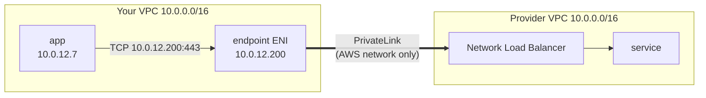
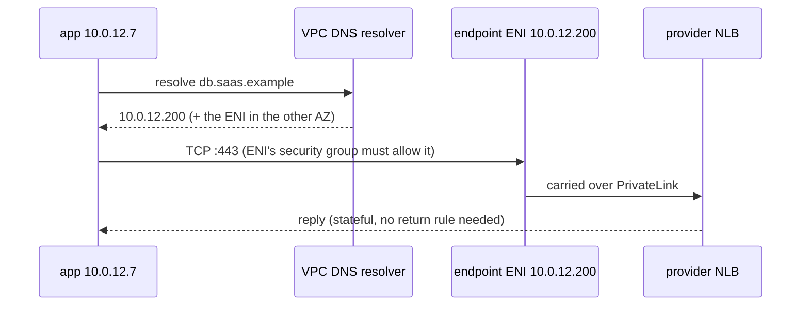

Only the AWS services that are critical or genuinely worth learning. Each section follows the same shape:

1. **The problem** it exists to solve.
2. **The idea**, the one design decision everything else follows from.
3. **How it works**, enough to reason about it.
4. **Traps**, and how to debug them.

Pricing, quotas and every flag are left to the AWS docs, which are linked at the end of each section.

---

## PrivateLink

### The problem

Your app runs in a private subnet. A service you need, such as a managed database, another team's API or a SaaS product, runs in **someone else's VPC**, often in another account. How do you connect the two without the internet?

The two obvious answers both connect **networks**:

- **Internet + NAT.** The service must be public, and your NAT IPs become your identity on an allow-list.
- **VPC peering / Transit Gateway.** These need non-overlapping CIDRs, and everyone picks `10.0.0.0/16`. Once routes exist, **every host can reach every host** both ways. You wanted one service on one port.

```
 your VPC 10.0.0.0/16  ◄──── peering? ────►  their VPC 10.0.0.0/16
                          ✗ same CIDR: "route 10.0.0.0/16 → peer" is meaningless
```

### The idea: a door, not a bridge

Don't join the networks. Put a **private IP address for that one service inside your own subnet**.



- **Provider side:** a Network Load Balancer in front of the service, published as an **endpoint service** (`com.amazonaws.vpce.<region>.vpce-svc-…`).
- **Your side:** an **interface endpoint**, which is one network interface (ENI) per chosen AZ, each with a private IP **from your subnet**.

Everything follows from that:

| Property | Why |
|---|---|
| Overlapping CIDRs are fine | No routes are exchanged. The ENI is just a local address |
| One service, not a network | The door opens onto one NLB, on the ports it listens on |
| One-way | You connect in. The provider can't connect back through it |
| Provider never sees your IPs | It sees its NLB's private IP. If it needs to know who you are, it identifies you by **endpoint ID** (Proxy Protocol v2) |

### How a request flows



Two steps can fail here: **DNS** (does the name resolve to the ENIs?) and **permission** (will both sides let the connection through?).

### Who controls what

Both sides have to say yes:

| Provider controls | You control |
|---|---|
| Which AWS accounts may create endpoints (allowed principals) | Which subnets/AZs get an ENI |
| Auto-accept or manual approval, and can reject later | **Security group on the ENIs**: which of your hosts, which ports |
| Often an app-level allow-list: you register your **endpoint ID** in their console | **DNS**: which names resolve to the ENIs |

The SaaS allow-list is the step people forget. AWS shows the endpoint as `Available`, and the provider still resets every connection until the ID is registered. For third-party services the endpoint policy allows everything, so **the security group is your control**. Admit only the subnets that need it, never "the whole VPC" if some subnets run untrusted code.

### DNS: where it usually breaks

The endpoint gives you IPs. Your app uses a hostname. There are two ways to connect them:

| | Private DNS **on** | Private DNS **off** + your own zone |
|---|---|---|
| How | Provider publishes a verified name. AWS adds a hidden private zone to your VPC | You create a Route 53 private zone **named after the exact hostname**, with an alias to the endpoint's regional DNS name |
| Effort | Zero | One zone + one record |
| Catch | If the name is a **wildcard** (`*.db.saas.example`), this one endpoint answers **every** name under it in your VPC. **Only one endpoint per VPC can own a private DNS name**: a second fails with "conflicting DNS domain" | None, as long as the zone is the exact name, not the parent domain |

Two resolver rules explain most surprises:

1. **The most specific zone wins.** An exact-name zone `tenant-a.db.saas.example` beats a wildcard zone `db.saas.example`, but only for that one name. So you can add a dedicated endpoint for one name even when another endpoint's private DNS already covers the domain.
2. **No fallback.** Once the resolver picks a zone, a missing record is **NXDOMAIN**. It doesn't try the parent zone or public DNS. That's why you never create a zone for the parent domain just to add one record: you'd black out every other name under it.

### The friendly-name trap

You'd like `db.internal.mycompany` instead of the provider's ugly name, so you add a CNAME. DNS resolves, and **the connection is reset**.

A multi-tenant provider serves everyone from the same IPs and picks your tenant from the **TLS SNI**, which is the name **your client was given**. A CNAME changes where DNS points, not what the client sends:

| Same IP, name in the TLS handshake | Result |
|---|---|
| provider's real hostname | `200 OK` |
| `db.internal.mycompany` | connection reset |
| `db.internal.mycompany`, with the real name in the HTTP `Host` header | connection reset: routing happens before HTTP |

The certificate wouldn't match your name either. Put the real hostname in one config value. If you really need an alias, the only working options are a TLS "server name" override in every client, or a TLS-terminating proxy you run.

### Not to be confused with gateway endpoints

**Gateway endpoints** exist only for S3 and DynamoDB. They're a **route-table entry**, not ENIs, and they're free. Add one for S3 in every VPC. Interface endpoints (PrivateLink) cost an hourly charge per AZ plus a per-GB charge, so cost grows with **endpoints × AZs**.

### When it breaks

| Symptom | Likely cause |
|---|---|
| `NXDOMAIN` | No zone answers the name, or a **more specific zone without a record** shadows it |
| Resolves to a **public** IP | Private DNS off and no zone of your own, or the client isn't using the VPC resolver |
| **Timeout** | Endpoint security group doesn't admit this subnet/port, or a NACL blocks it |
| **Connection reset** | Endpoint ID not registered with the provider, or the **SNI isn't a name they serve** |
| TLS certificate error | Connecting by an alias, IP, or the `vpce-…` DNS name |
| Stuck `pendingAcceptance` / `rejected` | Provider side: manual approval or rejection |
| "conflicting DNS domain" on create | Another endpoint already owns that private DNS name, so turn private DNS off on the new one |

Endpoint ENIs don't answer ping. Test with `curl`, `nc`, or the real client.

### In one breath

> PrivateLink puts a private IP for **one** remote service inside **your** subnets. Routing is trivial and safe by construction: no routes, no CIDR clashes, one-way. All the work is in **who may connect** (provider's allow-list + your security group) and **which names resolve to that IP** (private DNS, or your own exact-name zone), and in using the **provider's own hostname**.

**Docs:** [Concepts](https://docs.aws.amazon.com/vpc/latest/privatelink/concepts.html) · [Private DNS names](https://docs.aws.amazon.com/vpc/latest/privatelink/manage-dns-names.html) · [Interface endpoints](https://docs.aws.amazon.com/vpc/latest/privatelink/interface-endpoints.html) · [NLB: source IP & Proxy Protocol v2](https://docs.aws.amazon.com/elasticloadbalancing/latest/network/edit-target-group-attributes.html) · [Route 53 overlapping private zones](https://docs.aws.amazon.com/Route53/latest/DeveloperGuide/hosted-zone-private-considerations.html) · ["Conflicting DNS domain"](https://repost.aws/knowledge-center/vpc-interface-endpoint-domain-conflict) · [Pricing](https://aws.amazon.com/privatelink/pricing/) · [Quotas](https://docs.aws.amazon.com/vpc/latest/privatelink/vpc-limits-endpoints.html)
