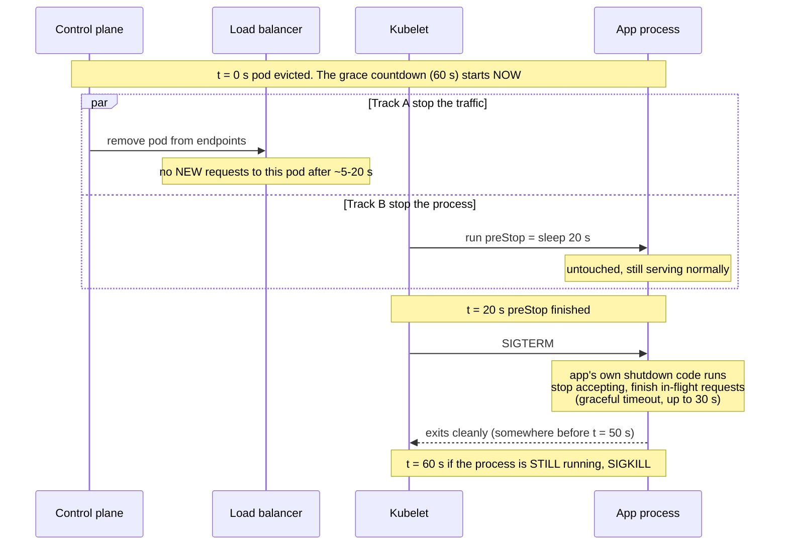
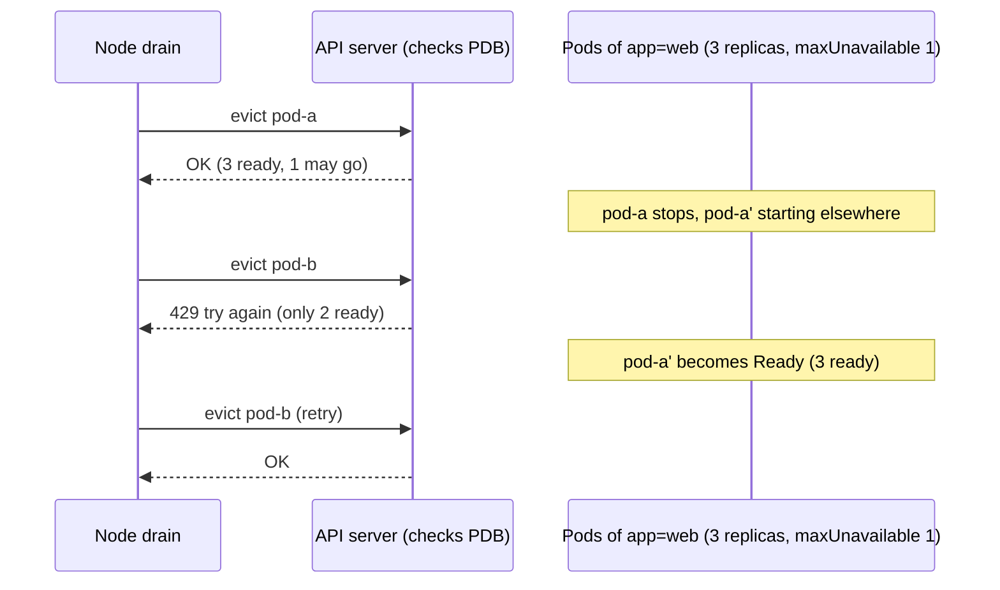
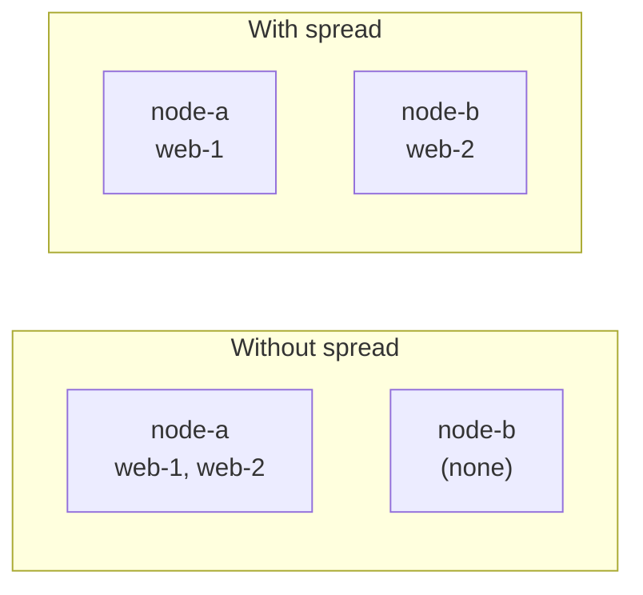
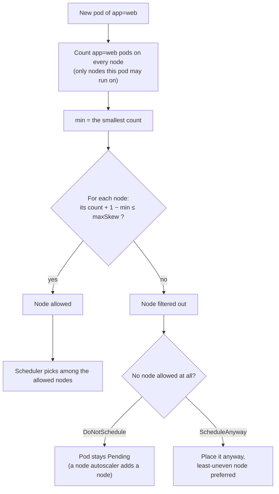

Nodes get replaced all the time: kernel patches, AMI updates, autoscaler consolidation. Replacing a node means **draining** it: every pod on it is evicted and started somewhere else. Done carelessly, users see `502`/`503`. These are the few pieces that make a drain invisible.

---

## 1. Shutting down one pod: the race and the timers

When a pod is evicted, two things start **at the same time**:

- **Track A, stop the traffic:** the pod is removed from the Service endpoints. kube-proxy updates in ~1–2 s. A cloud load balancer takes ~5–20 s to stop sending to the pod.
- **Track B, stop the process:** the kubelet starts shutting the container down.

If B finishes before A, the load balancer still sends requests to a dead process, and you get `502`. These timers decide how B plays out. **They're one sequence, so set them together.**

### Who does what, in order



### How the timers nest

```mermaid
gantt
    title Example values, preStop 20 + app timeout 30 + buffer 10 = grace 60
    dateFormat ss
    axisFormat %M:%S
    section Pod spec
    terminationGracePeriodSeconds 60 s total  :grace, 00, 60s
    preStop sleep 20 s                        :pre, 00, 20s
    section App code
    graceful timeout 30 s after SIGTERM       :app, after pre, 30s
    spare buffer 10 s                         :buf, after app, 10s
    section LB
    LB stops new requests                     :lb, 00, 20s
```



| Timer | Where it lives | What it does | Typical value |
|---|---|---|---|
| `preStop` sleep | pod spec, `lifecycle.preStop` | Keeps the process untouched while track A finishes. SIGTERM is only sent **after** preStop ends | 15–20 s |
| App graceful timeout | the app server's own setting | After SIGTERM: how long the app waits for in-flight requests before it kills them itself | ≥ your longest request |
| `terminationGracePeriodSeconds` | pod spec | **Total** budget, counted **from t=0, including preStop**. When it runs out: SIGKILL | preStop + app timeout + ~10 s |
| LB deregistration delay | the load balancer's target group | How long the LB lets **already open** connections to the pod finish. When it runs out, the LB drops them itself | ≥ how long the pod keeps serving them |

**The rule:** `terminationGracePeriodSeconds ≥ preStop + app graceful timeout + buffer`

```yaml
spec:
  terminationGracePeriodSeconds: 60      # 20 + 30 + 10 buffer
  containers:
    - name: web
      lifecycle:
        preStop:
          sleep:
            seconds: 20                  # built-in since k8s 1.30 (stable 1.34)
      # app side: e.g. gunicorn --graceful-timeout 30
```

### SIGTERM and your code

SIGTERM is only an OS **signal** sent to the container's main process (PID 1). Kubernetes does nothing else. **Whether it becomes a graceful shutdown is decided entirely by the code running in the container.**

| What runs as PID 1 | What SIGTERM does |
|---|---|
| A server with a shutdown handler: gunicorn, uvicorn, Go `http.Server.Shutdown`, Node `server.close()`, Spring `server.shutdown=graceful` | Graceful: the 4 steps below |
| Your own program with **no** handler | As PID 1 the kernel **ignores** the signal. The app keeps running and is SIGKILLed at the end of the grace period |
| A shell: `sh -c "python app.py"`, or a shell-form `CMD` | The shell gets SIGTERM and does **not** pass it on. The app never hears it and gets SIGKILLed. Fix: exec-form `CMD`, `exec` in the script, or `tini` |

A graceful shutdown does four things:
1. **Closes the listening socket.** New connections are now **refused**. That's why the LB must have stopped sending *before* this, which is the preStop's job.
2. Closes **idle** keep-alive connections.
3. Lets **in-flight** requests finish, up to the graceful timeout.
4. Exits.

Two cases where this isn't enough:
- **Long-lived connections** (WebSocket, streaming, gRPC streams). Many servers **close them immediately** on SIGTERM, because they aren't "in-flight requests". The fixes:
  - a real drain in the app: stop admitting new sessions, let existing ones end, tell clients to reconnect;
  - or a **long preStop as the drain**: the process is left alone while the sessions finish. Then the preStop is sized from session length, the grace period must be above it, and the **LB deregistration delay must be ≥ the preStop**. Otherwise the LB itself cuts the sessions when its own timer expires.
- **Queue workers** (no load balancer in front). A preStop sleep doesn't help them; the worker keeps **pulling new jobs** during it. Instead, the worker handles SIGTERM: it stops consuming and finishes the current job. Set the grace period ≥ your longest job; the preStop can be 0.

### What goes wrong when they don't line up

| Mistake | Result |
|---|---|
| No preStop | SIGTERM arrives while the LB still sends traffic → **502** |
| App graceful timeout < longest request | The app kills its own slow requests → **502** |
| Grace period < preStop + app timeout | The kubelet SIGKILLs mid-request → **502/504** |
| Grace period still at the 30 s default with a 20 s preStop | The app gets only 10 s to drain |
| LB deregistration delay < how long connections need | The LB drops them, even though the pod is still alive |
| App doesn't handle SIGTERM (or a shell eats it) | Every shutdown is a SIGKILL |

One more app-side detail: the app's **keep-alive idle timeout should be longer than the load balancer's**. Otherwise the app closes an idle connection at the exact moment the LB reuses it, and you get a random 502.

---

## 2. PodDisruptionBudget (PDB): how many pods may be down at once

Section 1 makes **one** pod's shutdown clean. A PDB makes sure that **not too many** pods of the same app shut down together.

### How it works
- Node drains, autoscalers and managed node upgrades **evict** pods through the **Eviction API**. They don't delete them directly.
- Before each eviction, the API server checks the PDB. If evicting the pod would break the budget, it answers **429: try again later**, and the drain retries.
- When a replacement pod becomes **Ready**, the budget frees up and the next eviction goes through.



`kubectl get pdb` shows the live answer in the **ALLOWED DISRUPTIONS** column.

### The settings
```yaml
apiVersion: policy/v1
kind: PodDisruptionBudget
metadata:
  name: web
spec:
  maxUnavailable: 1          # OR minAvailable, never both
  selector:
    matchLabels:
      app: web
  unhealthyPodEvictionPolicy: AlwaysAllow   # optional, see below
```

| Field                        | Meaning                                           | Notes                                                                                                                                            |
| ---------------------------- | ------------------------------------------------- | ------------------------------------------------------------------------------------------------------------------------------------------------ |
| `minAvailable`               | At least this many must stay Ready                | A number or `"%"`. Percentages **round up**                                                                                                      |
| `maxUnavailable`             | At most this many may be down                     | A number or `"%"`. Percentages **round up** too. It **scales with replicas**, so it's usually the better choice                                  |
| `selector`                   | Which pods it guards                              | Must match the Deployment's pod labels                                                                                                           |
| `unhealthyPodEvictionPolicy` | Can pods that are *already* not Ready be evicted? | `IfHealthyBudget` (default): only if the budget allows. `AlwaysAllow`: yes, always. This stops a crash-looping pod from blocking a drain forever |

### The trap: budgets that allow zero
| Config | Replicas | Allowed disruptions | Result |
|---|---|---|---|
| `minAvailable: 1` | 1 | 0 | The drain is **blocked forever** |
| `minAvailable: 70%` | 2 | 0 (70% of 2 rounds up to 2) | Blocked forever |
| `maxUnavailable: 0` | any | 0 | Blocked forever, on purpose |
| `maxUnavailable: 1` | ≥2 | 1 | ✅ rolls one at a time |

A blocked drain doesn't fail safely. The upgrade times out, or a hard deadline force-kills the pods anyway. **A PDB must always allow at least 1.**

### What a PDB does *not* cover
- **Involuntary loss:** a node crash or kernel panic ignores PDBs.
- `kubectl delete pod`: that's a delete, not an eviction.
- **Deployment rollouts:** those use the Deployment's own settings (see §3).
- **Single-replica apps:** no budget can keep 1 pod up while moving it.

### Getting started
1. Find the zero-budget PDBs: `kubectl get pdb -A` and look for `ALLOWED DISRUPTIONS = 0`.
2. Every Deployment that serves traffic gets **≥2 replicas** and `maxUnavailable: 1` (or `25%` for big ones).
3. Stateful quorum systems (etcd, ZooKeeper, Keeper): `maxUnavailable: 1`.
4. Batch Jobs: usually no PDB; the Job controller re-runs the pod.

---

## 3. A Deployment's own `maxUnavailable`, and how it differs from the PDB's

A Deployment has its **own** `maxUnavailable`, but it controls something different:

```yaml
kind: Deployment
spec:
  replicas: 4
  strategy:
    type: RollingUpdate
    rollingUpdate:
      maxSurge: 25%          # default: extra NEW pods allowed above replicas (rounds up)
      maxUnavailable: 25%    # default: OLD pods that may be down below replicas (rounds down)
```

| | Deployment `maxUnavailable` | PDB `maxUnavailable` |
|---|---|---|
| Guards against | **Your own rollout**: a new image or config | **Evictions**: node drain, upgrade, autoscaler |
| Who enforces it | The Deployment controller, as it replaces pods | The API server, on each eviction request |
| Mechanism | Creates new pods (surge) and removes old ones step by step | Answers 429 to the eviction until it's safe |
| Is the other one consulted? | No, rollouts ignore PDBs | No, drains ignore the Deployment strategy |

They don't know about each other, so you need **both**:
- the Deployment strategy makes `kubectl set image` safe;
- the PDB makes a node drain safe.

A common safe rollout setting is `maxSurge: 1, maxUnavailable: 0`: start a new pod, wait for Ready, then remove an old one.

---

## 4. Spreading replicas across nodes

### The problem
A PDB limits **how many** pods go at once. It says nothing about **where** they run. Without a rule, the scheduler may put replicas on the same node:



- **Without spread**, if node-a crashes, both replicas die at once (a PDB can't help with a crash). If node-a is drained, the PDB lets only one go at a time, so the drain is slow.
- **With spread**, losing any one node costs one replica.

By default the scheduler does try to spread, but **only softly**: it tolerates up to 3 more replicas on one node than another (per zone: 5), and stacks them anyway if that's easier. So "both replicas on one node" is normal behaviour without a rule.

### The rule: "keep the counts even"
Think of dealing cards. Each new pod goes to a node so that **no node gets more than `maxSkew` pods ahead of the emptiest node**.

```yaml
topologySpreadConstraints:
  - maxSkew: 1                               # max allowed difference between nodes
    topologyKey: kubernetes.io/hostname      # what counts as "a place": each node
    whenUnsatisfiable: DoNotSchedule         # if no node fits: wait (or ScheduleAnyway)
    labelSelector:
      matchLabels: { app: web }              # which pods to count: this app's own pods
```

For each new pod, the scheduler checks every node:



### Worked example: 5 replicas, 3 nodes, maxSkew 1

| Pod | Counts before (a, b, c) | min | a: count+1−min | b | c | Placed on |
|---|---|---|---|---|---|---|
| web-1 | 0, 0, 0 | 0 | 1 ✓ | 1 ✓ | 1 ✓ | a (any was fine) |
| web-2 | 1, 0, 0 | 0 | **2 ✗** | 1 ✓ | 1 ✓ | b |
| web-3 | 1, 1, 0 | 0 | **2 ✗** | **2 ✗** | 1 ✓ | c (the only choice) |
| web-4 | 1, 1, 1 | 1 | 1 ✓ | 1 ✓ | 1 ✓ | a |
| web-5 | 2, 1, 1 | 1 | **2 ✗** | 1 ✓ | 1 ✓ | b |

Result: **2, 2, 1**. No node is more than 1 ahead, and losing any one node costs at most 2 of the 5.

### What happens during a drain
Node-c is drained, and a new empty node-d joins:
- web-3 (on c) is evicted. Its replacement is a new pod, so the rule runs again.
- Counts are a = 2, b = 2, d = 0, so min = 0. a and b give 2 + 1 − 0 = 3 ✗; d gives 1 ✓. **The replacement lands on the empty node.**
- The spread survives the drain.

### The options

| Option | Meaning |
|---|---|
| `whenUnsatisfiable: DoNotSchedule` | **Hard.** The pod stays `Pending` rather than break the spread. A node autoscaler then adds a node |
| `whenUnsatisfiable: ScheduleAnyway` | **Soft.** It prefers the most even node, but will stack if it must |
| `topologyKey: topology.kubernetes.io/zone` | Spread across AZs instead of nodes. You can list **both** keys as two constraints |
| `minDomains: N` | "Act as if at least N nodes exist." With fewer nodes, the empty imaginary ones count as min = 0, which forces new nodes to be created |

### Things to know
- It's checked **only when a pod is scheduled**. It never moves running pods. After a scale-down, the layout can become uneven until pods are recreated (or a Descheduler runs).
- The `labelSelector` must match the pod's **own** labels. Otherwise the scheduler counts the wrong pods, and the spread silently does nothing.
- Only nodes the pod is **allowed** on (its nodeSelector or affinity) count as places.
- An alternative is `podAntiAffinity` ("never two `app=web` on one node"). It's stricter: with more replicas than nodes, the extra pods can't schedule at all.

---

## 5. Load-balancer readiness gates

"Ready" in Kubernetes means *the probe passed*. It does **not** mean *the load balancer is sending traffic here yet*. During a drain, a new pod can be Ready, so the PDB frees up and the old pod is evicted, while the LB is still registering the new one. The target group then has no healthy targets, and you get a 503.

The **AWS Load Balancer Controller** fixes this. Label the namespace:

```bash
kubectl label namespace web elbv2.k8s.aws/pod-readiness-gate-inject=enabled
```

New pods then get an extra readiness condition (`target-health.elbv2.k8s.aws/...`). They only count as Ready once the ALB health check passes, so the PDB waits for **real** traffic readiness.

Caveats:
- This only works with `target-type: ip`.
- It's injected **at pod creation**, so existing pods need a restart to get it.

---

## 6. Checklist

| # | Item | Prevents |
|---|---|---|
| 1 | preStop, app graceful timeout, grace period and LB deregistration delay, set together (§1) | 502/504 when a pod stops |
| 2 | The app actually handles SIGTERM (exec-form `CMD`, a real handler) | Every shutdown being a SIGKILL |
| 3 | ≥2 replicas | 503: nothing left to serve |
| 4 | PDB `maxUnavailable: 1` (never 0 allowed) | 503 from too many evicted at once; stuck drains |
| 5 | Deployment `maxSurge: 1, maxUnavailable: 0` | 503 during your own rollouts |
| 6 | Topology spread (node and zone) | Losing all replicas with one node |
| 7 | Keep-alive idle > LB idle | Random 502s |
| 8 | LB readiness gates | 503: "Ready" before the LB is actually sending traffic |

**Prove it:** run steady load through the load balancer, drain a node, and count non-2xx responses. Do it once before the changes and once after. The goal is zero.
