This is part 3 of a series. [Part 1](../kubernetes-networking/) built Kubernetes networking from Linux primitives. [Part 2](../kubernetes-network-policies/) built NetworkPolicy, eBPF and Cilium from first principles. This part takes all of that to **Amazon EKS**, where there are three serious ways to enforce network policy:

1. the **Amazon VPC CNI's built-in network policy agent** (the AWS-native option),
2. **Cilium**, and
3. **Calico**.

There's also **security groups for pods**, which isn't network policy but often gets confused with it.

The note starts from zero again, briefly. Each idea gets a diagram, then the EKS-specific detail is layered on top. By the end you should be able to explain what each piece does, why it exists, and which one to choose.

Versions this note is written against (November 2026):

| Thing | Version |
|---|---|
| Kubernetes NetworkPolicy | `networking.k8s.io/v1` (docs as of v1.37, unchanged in years) |
| Amazon VPC CNI | v1.21.1+ for cluster-wide policy; **v1.22.4+** recommended (security fixes, see §6.7) |
| EKS ClusterNetworkPolicy / ApplicationNetworkPolicy | `networking.k8s.aws/v1alpha1` (launched Dec 15, 2025) |
| Upstream ClusterNetworkPolicy | `policy.networking.k8s.io`, `v1alpha2` |
| Cilium | 1.20.5 (Nov 2026) |
| Calico Open Source | 3.33.1 (Nov 2026) |

---

## 1. The problem, from first principles

### 1.1 A Kubernetes cluster is one flat network

Kubernetes' network model has one rule that matters here: **every pod can reach every other pod's IP directly**, with no NAT, across nodes and namespaces. That makes service discovery and load balancing simple. It also means there's no wall anywhere inside the cluster.

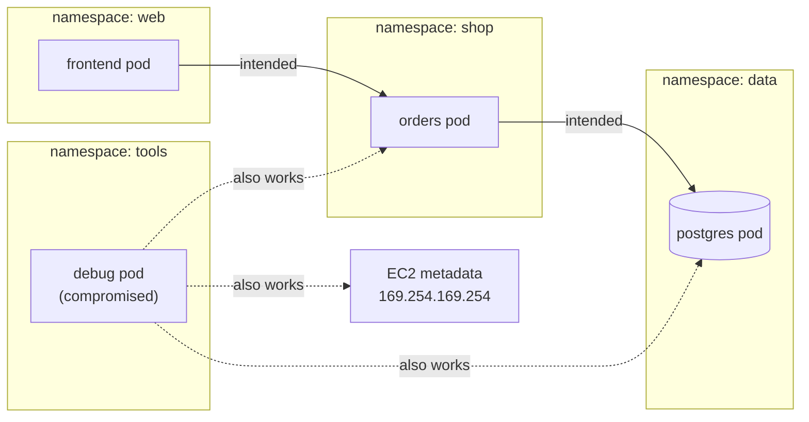

If an attacker gets code execution in *any* pod (a vulnerable library, a leaked token, a bad image), they can scan and connect to everything else. That's called **lateral movement**, and the flat network makes it trivial. What we want instead is **least privilege for the network**: each workload can talk only to what it needs.

### 1.2 Why not just use AWS security groups?

On EKS this question matters more than anywhere else, because of how the VPC CNI hands out IPs.

**On EKS, pod IPs are real VPC IPs.** The default CNI (the Amazon VPC CNI) takes IP addresses from your **subnet**, which means from your **VPC CIDR**, and gives them to pods. A pod might be `10.0.42.17`, a normal address in the VPC. There's no overlay and no NAT inside the VPC. (Section 5 explains how.)

So pods are visible to the VPC's own controls: route tables, NACLs, security groups, VPC flow logs. Why aren't those enough?

1. **Security groups attach to an ENI, not to a pod.** With the VPC CNI, many pods share the node's network interfaces (ENIs). All pods on the same ENI share the same security groups. You can't say "the `orders` pod may reach the DB but the `debug` pod on the same node may not".
2. **NACLs work per subnet and are stateless.** They're far too coarse, and pods of every app sit in the same subnets.
3. **IPs are ephemeral.** A pod's IP changes every time it's rescheduled. Any rule written with IPs is wrong within minutes.
4. **A lot of traffic never leaves the node.** Two pods on the same node talk over the node's internal bridge or routes. That traffic never touches a VPC-level control at all.
5. **What you want to name is a workload, not a machine.** "The `orders` app" is a set of labels. AWS controls don't understand Kubernetes labels.

> **Trap worth knowing early:** because pod IPs come from the VPC CIDR, a policy rule like `ipBlock: 10.0.0.0/16` (your VPC CIDR) **also matches every pod**. Kubernetes leaves this implementation-defined. On EKS, assume a VPC-CIDR `ipBlock` opens traffic to all pods, not just "things in the VPC". Use `except`, or use selectors for pods.

### 1.3 What we actually need

From those failures, the requirements fall out directly:

| Requirement | Why |
|---|---|
| Rules written in **labels**, not IPs | IPs are ephemeral, labels follow the workload |
| Enforced **at each pod's own interface** | Catches same-node traffic, per-pod granularity |
| **Stateful** (replies allowed automatically) | You only describe who may *start* a connection |
| **Default-deny** possible | Least privilege means "nothing unless allowed" |
| Updated **automatically** as pods come and go | The control plane must track the churn |
| Both **ingress** and **egress** | Egress stops data exfiltration and reaching IMDS |

That's exactly what Kubernetes **NetworkPolicy** is: a firewall written in labels, enforced at each pod's network interface by the CNI.

---

## 2. The vocabulary

You'll meet all of these words. Read the table once now and come back to it later.

**Networking building blocks**

| Term | Meaning |
|---|---|
| **CNI** (Container Network Interface) | The spec and plugins that give a pod its network interface and IP. On EKS the default is the Amazon VPC CNI (`aws-node` DaemonSet). |
| **IPAM** | IP Address Management: who decides which IP a pod gets. |
| **veth pair** | A virtual cable. One end is `eth0` inside the pod, the other end sits on the node. Policy is usually enforced on the **node side** of this cable. |
| **ENI** | Elastic Network Interface: an AWS virtual NIC attached to an EC2 instance. Has security groups and a set of private IPs. |
| **Secondary IP / prefix delegation** | The VPC CNI gives pods extra IPs from an ENI, either one at a time or in `/28` prefixes (16 IPs). |
| **Trunk / branch ENI** | Used by security groups for pods: one trunk ENI per node, one branch ENI per pod. |
| **Overlay** | Pods get IPs from a private range that isn't in the VPC, and traffic is tunneled (e.g. VXLAN) between nodes. |
| **Native / VPC routing** | Pod IPs are real VPC IPs, routed by the VPC itself. No tunnel. |
| **CNI chaining** | Two CNI plugins together: one sets up networking (e.g. VPC CNI), the other adds policy (e.g. Cilium). |
| **Control plane / data plane** | Control plane: the software that watches the API and decides. Data plane: the kernel code that handles each packet. |
| **conntrack** | The kernel's connection tracker. It's why replies are allowed automatically (stateful filtering). |
| **iptables / nftables** | Linux's classic packet-filter rule tables. |
| **eBPF** | Small verified programs loaded into the running kernel, attached to hooks like a network interface. Policy lookups become hash-map lookups. |
| **tc hook** | Traffic-control hook on an interface where eBPF programs see every packet in or out. |

**Policy concepts**

| Term | Meaning |
|---|---|
| **East-west / north-south** | East-west: traffic between workloads inside the cluster. North-south: traffic into or out of the cluster. |
| **Microsegmentation** | Splitting the network into tiny zones (per workload) with rules between them. NetworkPolicy is a microsegmentation tool. |
| **Ingress / egress** | Traffic coming **into** the selected pod / going **out of** it. Not the same as an Ingress *resource*. |
| **Selector** | A label query (`app=orders`) that picks pods or namespaces. |
| **Isolated pod** | A pod selected by a policy for a direction. In that direction it is deny-by-default. |
| **Peer** | The other side of a rule: pods, namespaces, or an IP block. |
| **Default-deny** | A policy that selects pods and allows nothing, so only what other policies allow gets through. |
| **L3 / L4 / L7** | IP addresses / ports and protocols / application data (HTTP path, gRPC method, DNS name). |
| **FQDN policy** | An egress rule by DNS name (`api.example.com`) instead of IP. |
| **Identity** (Cilium) | A number derived from a pod's labels. Policy is enforced on identities, not IPs. |
| **Tier / priority / action** | The ordering model of cluster-wide policy: tiers run in order, priorities order rules inside a tier, and an action (Accept/Deny/Pass) decides. |
| **Audit / staged / log mode** | Run a policy without enforcing it, to see what *would* be dropped. |
| **Enforcement mode** (VPC CNI) | `standard` (new pods start allow-all until rules land) or `strict` (new pods start deny-all). |

**Kubernetes and AWS objects**

| Object | Who owns it | Scope |
|---|---|---|
| `NetworkPolicy` (`networking.k8s.io/v1`) | Kubernetes, enforced by your CNI | Namespace |
| `ClusterNetworkPolicy` (`policy.networking.k8s.io/v1alpha2`) | Upstream SIG Network, alpha | Cluster |
| `ClusterNetworkPolicy` (`networking.k8s.aws/v1alpha1`) | AWS VPC CNI | Cluster |
| `ApplicationNetworkPolicy` (`networking.k8s.aws/v1alpha1`) | AWS VPC CNI, Auto Mode only for FQDN | Namespace |
| `PolicyEndpoint` (`networking.k8s.aws`) | Internal to the VPC CNI. Don't edit it. | Namespace |
| `SecurityGroupPolicy` (`vpcresources.k8s.aws/v1beta1`) | AWS VPC resource controller | Namespace |
| `CiliumNetworkPolicy` / `CiliumClusterwideNetworkPolicy` (`cilium.io/v2`) | Cilium | Namespace / cluster |
| `NetworkPolicy` / `GlobalNetworkPolicy` / `Tier` (`projectcalico.org/v3`) | Calico | Namespace / cluster |

---

## 3. The Kubernetes NetworkPolicy model

Part 2 covers this in depth. Here's what you need to carry forward.

### 3.1 Kubernetes stores the policy, the CNI enforces it

This is the most important fact about network policy, and the most common surprise:

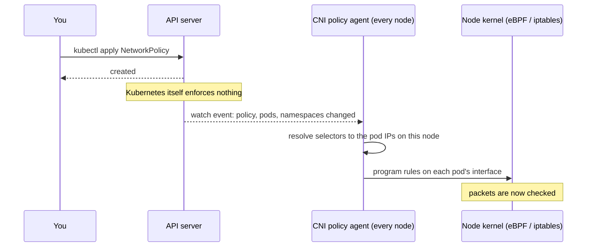

If nothing on your nodes implements NetworkPolicy, `kubectl apply` succeeds and **nothing happens**. On EKS that's the default state: the VPC CNI's policy support is **off** until you turn it on (§6.3).

### 3.2 The six rules

1. **Default allow.** A pod that no policy selects is not isolated. Everything in and out is allowed.
2. **Selection isolates, per direction.** If a policy selects a pod and lists `Ingress` in `policyTypes`, that pod's ingress becomes deny-by-default. Egress works the same way, independently.
3. **Policies only add allows.** No deny rules, no ordering. Multiple policies on one pod are a **union**.
4. **Both ends must agree.** A→B works only if A's egress allows it **and** B's ingress allows it.
5. **Replies are free.** Allowed connections get their reply packets automatically (conntrack).
6. **The node can reach its pods.** Kubelet health probes keep working under default-deny.

Here's rule 4 as a decision flow for one new connection:

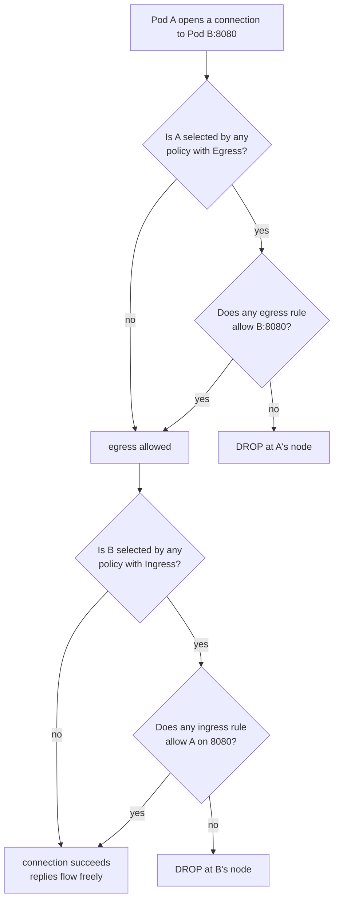

### 3.3 Anatomy of a policy

```yaml
apiVersion: networking.k8s.io/v1
kind: NetworkPolicy
metadata:
  name: orders-ingress
  namespace: shop
spec:
  podSelector:              # WHICH pods (in this namespace) this policy is about
    matchLabels:
      app: orders
  policyTypes: [Ingress]    # WHICH directions become deny-by-default
  ingress:                  # WHAT is allowed in. Each list item is OR'd.
    - from:                 #   from these peers...
        - namespaceSelector:
            matchLabels:
              kubernetes.io/metadata.name: web
          podSelector:      #   (same list item = AND: frontend pods IN namespace web)
            matchLabels:
              app: frontend
      ports:                #   ...on these ports
        - protocol: TCP
          port: 8080
```

The peer types are `podSelector` (pods in the **policy's own** namespace), `namespaceSelector` (all pods in matching namespaces), both together in **one** item (pods matching both: AND), and `ipBlock` (a CIDR with optional `except`). Putting `namespaceSelector` and `podSelector` as **two** list items means OR, which is the classic mistake. Part 2 §2.4 has the details.

### 3.4 The four policies almost everyone starts with

```yaml
# 1. Default-deny everything in a namespace (both directions)
apiVersion: networking.k8s.io/v1
kind: NetworkPolicy
metadata: { name: default-deny, namespace: shop }
spec:
  podSelector: {}               # every pod in the namespace
  policyTypes: [Ingress, Egress]
---
# 2. ...which breaks DNS, so allow DNS to CoreDNS (UDP and TCP)
apiVersion: networking.k8s.io/v1
kind: NetworkPolicy
metadata: { name: allow-dns, namespace: shop }
spec:
  podSelector: {}
  policyTypes: [Egress]
  egress:
    - to:
        - namespaceSelector:
            matchLabels: { kubernetes.io/metadata.name: kube-system }
          podSelector:
            matchLabels: { k8s-app: kube-dns }
      ports:
        - { protocol: UDP, port: 53 }
        - { protocol: TCP, port: 53 }
---
# 3. Pods in the same namespace may talk to each other
apiVersion: networking.k8s.io/v1
kind: NetworkPolicy
metadata: { name: allow-same-namespace, namespace: shop }
spec:
  podSelector: {}
  policyTypes: [Ingress, Egress]
  ingress: [ { from: [ { podSelector: {} } ] } ]
  egress:  [ { to:   [ { podSelector: {} } ] } ]
---
# 4. Egress to the internet, but NOT to the VPC or IMDS
apiVersion: networking.k8s.io/v1
kind: NetworkPolicy
metadata: { name: allow-internet-egress, namespace: shop }
spec:
  podSelector: { matchLabels: { needs-internet: "true" } }
  policyTypes: [Egress]
  egress:
    - to:
        - ipBlock:
            cidr: 0.0.0.0/0
            except:
              - 10.0.0.0/16          # your VPC CIDR (this covers all pods on EKS!)
              - 169.254.169.254/32   # EC2 instance metadata (IMDS)
      ports:
        - { protocol: TCP, port: 443 }
```

### 3.5 What upstream NetworkPolicy can't do

The Kubernetes docs list the gaps explicitly. The ones that hurt most in practice:

- **No deny rules** and no ordering. You can't say "everyone except X".
- **No cluster-wide policy.** A platform team can't set a guardrail that namespace owners can't undo.
- **No DNS names.** Egress to `api.example.com` must be written as IPs, which change.
- **No L7.** You can't say "only `GET /health`".
- **No logging** of allowed or dropped traffic.
- **No targeting Services by name**, no node-level policy, nothing TLS-related.

Every enforcer below exists partly to fill those gaps, each in its own way:

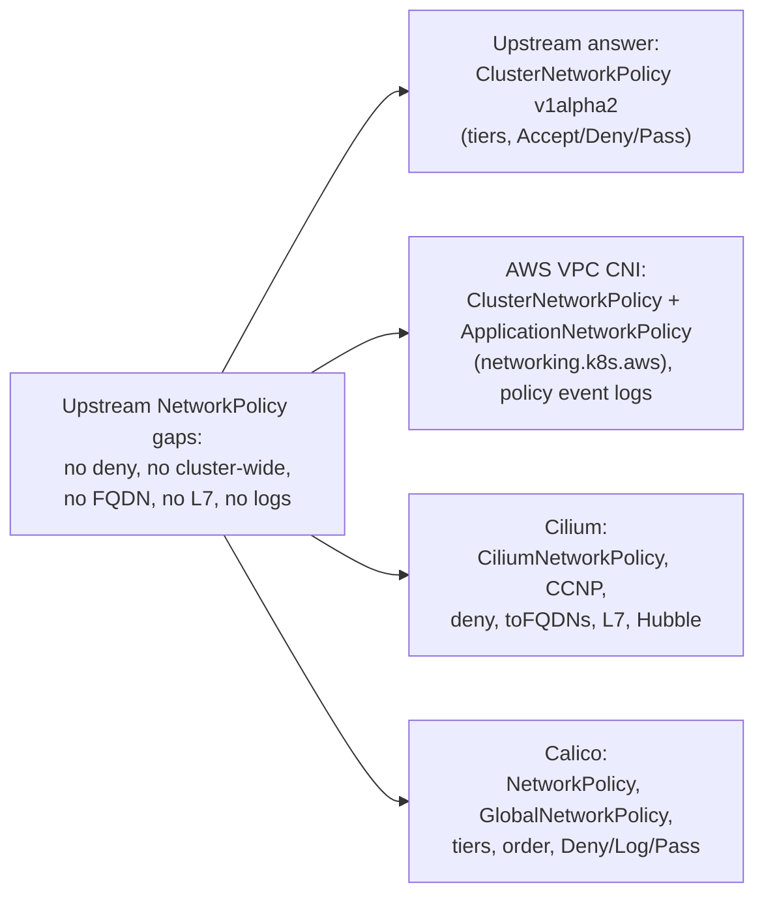

---

## 4. How enforcement works under the hood

Every enforcer, whatever its brand, runs the same loop:

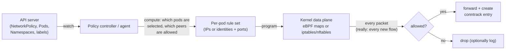

Where the check happens matters. Each pod's traffic passes through the **node-side end of its veth pair**. That's the perfect chokepoint: it's per pod, it sees same-node traffic, and the pod can't tamper with it.

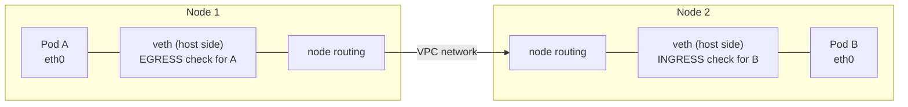

There are two ways to implement the check:

| | iptables / nftables | eBPF |
|---|---|---|
| How | Chains of rules + ipsets per pod | Programs on the veth's tc hook + hash maps |
| Per-packet cost | Small, but new-flow cost grows with rule count | A few hash lookups, roughly flat |
| Updates | Rewrite rule tables (slow at scale) | Update map entries (fast) |
| Who uses it | Classic Calico, kube-router | VPC CNI policy agent, Cilium, Calico eBPF mode |

For L3/L4 policy, eBPF enforcement adds no latency you'd notice at the application level. Part 2 §7 explains why.

---

## 5. EKS networking baseline: the Amazon VPC CNI

You can't understand any of the three options on EKS without knowing what the VPC CNI does, because two of them build on it.

### 5.1 How pods get VPC IPs

The VPC CNI runs as the `aws-node` DaemonSet. Its IPAM daemon (`ipamd`) attaches extra ENIs to the node and reserves **secondary private IPs** (or `/28` **prefixes** with prefix delegation) from the node's subnet. It keeps a warm pool so new pods start fast. When a pod starts, the CNI picks an IP from the pool and wires up a veth.

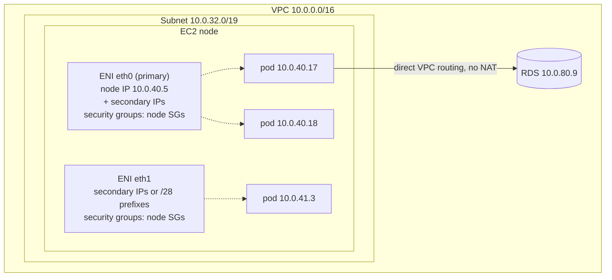

Consequences you should remember:

- **Pod IPs are VPC IPs.** Other VPC resources (RDS, EC2, peered VPCs, on-prem via VPN/Direct Connect) see the **real pod IP** as the source.
- **All pods on a node share the node's security groups** (the SGs of the ENI they borrow IPs from). The SG can't tell pods apart.
- **Max pods per node is limited by ENIs × IPs per ENI**, unless you use prefix delegation.
- **IP exhaustion** is a real risk in small subnets. That's a reason some people pick an overlay (Calico VXLAN, Cilium overlay). It's also why "custom networking" (pods in separate secondary-CIDR subnets) exists.

### 5.2 Which AWS layer controls what

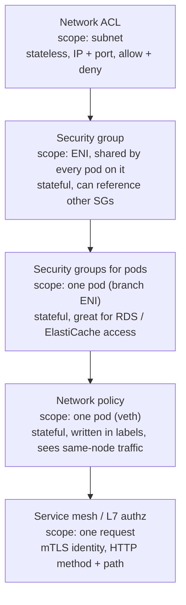

These are **layers, not alternatives**. A sensible EKS design uses NACLs rarely, SGs at the node and load balancer edge, network policy as the always-on pod-to-pod baseline, and maybe security groups for pods where an AWS service's SG must reference a specific workload.

---

## 6. Option A: the VPC CNI's built-in network policy

Since August 2023 the VPC CNI can enforce standard Kubernetes NetworkPolicy itself, using eBPF. You keep AWS's supported CNI and need no third-party software. Since December 2025 it also has cluster-wide and DNS-based policies.

### 6.1 Architecture

There are three moving parts:

1. **Network policy controller.** It runs in the **EKS control plane** (managed by AWS, you don't see a pod for it). It watches NetworkPolicies, Pods, Namespaces and Services, and resolves selectors into concrete IPs.
2. **`PolicyEndpoint` CRD** (`policyendpoints.networking.k8s.aws`). The controller writes its result here: "for policy X, these pod IPs are selected, and these IP/CIDR + port combinations are allowed". It's an internal object. AWS says don't modify or delete it.
3. **Network policy agent** (`aws-network-policy-agent`). It's a second container in every `aws-node` pod. It watches the PolicyEndpoints for pods on its node and loads **eBPF programs on each pod's host-side veth**, with eBPF maps holding the allowed CIDRs and ports.

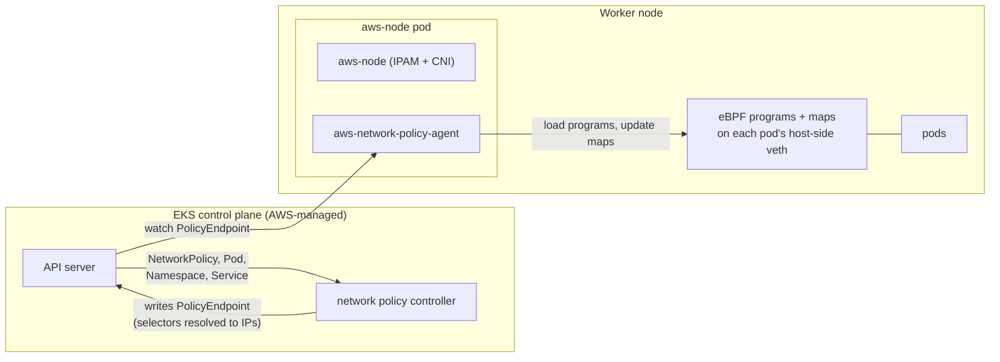

The full lifecycle when you apply a policy:

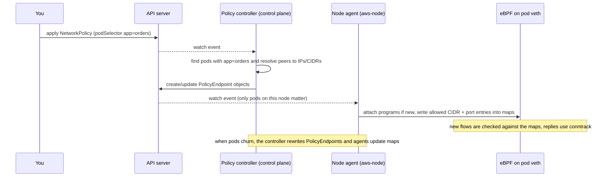

Because selectors are turned into **IP lists** by a central controller, every pod start or stop that a policy cares about means a PolicyEndpoint update. That's the price of a design that keeps the node agent simple.

### 6.2 Requirements and support matrix

| Item | Requirement |
|---|---|
| VPC CNI version | v1.14+ for standard NetworkPolicy. **v1.21.x** for ClusterNetworkPolicy. AWS's announcement says v1.21.1 and the user guide says v1.21.0, so target ≥ v1.21.1, and preferably latest (§6.7). |
| Kubernetes version | New clusters on **1.29+** for the enhanced (cluster-wide/DNS) policies, according to the launch announcement. |
| Node kernel | **Linux 5.10+**. Current EKS-optimized AL2023, accelerated AMIs and Bottlerocket qualify. |
| Node types | **EC2 Linux nodes only.** Not Fargate, not Windows. |
| Interfaces | Only the pod's **primary interface (`eth0`)**. Multus extra interfaces aren't covered. |
| IP family | IPv4 **or** IPv6 per cluster, not both. On an IPv6 cluster a pod's IPv4 egress (via `ENABLE_V4_EGRESS`) is not filtered. |
| Works with | Custom networking, prefix delegation, security groups for pods |
| Ports | 8162 (metrics) and 8163 (health probes) on the node by default. Both are configurable. |

> **Fargate gap:** VPC CNI network policy doesn't apply to Fargate pods, and Fargate doesn't allow alternative CNIs. For Fargate, security groups for pods is your only per-pod control.

### 6.3 Turning it on

With the managed EKS add-on (the common case), set one configuration value:

```bash
aws eks update-addon --cluster-name my-cluster --addon-name vpc-cni \
  --resolve-conflicts PRESERVE \
  --configuration-values '{"enableNetworkPolicy": "true"}'
```

The same thing via Helm:

```bash
helm upgrade aws-vpc-cni eks/aws-vpc-cni --namespace kube-system --set enableNetworkPolicy=true
```

For self-managed manifests, two pieces are needed: the control-plane controller is switched on by a ConfigMap, and the node agent by a flag.

```yaml
apiVersion: v1
kind: ConfigMap
metadata:
  name: amazon-vpc-cni
  namespace: kube-system
data:
  enable-network-policy-controller: "true"   # turns on the controller in the EKS control plane
---
# and in the aws-network-policy-agent container args:
#   --enable-network-policy=true
```

Check it worked: `kubectl get pods -n kube-system | grep aws-node` should show **2/2** containers.

### 6.4 Standard vs strict mode

This is the most important VPC CNI knob, and it comes from one race: a new pod gets its IP and starts **before** the controller and agent have finished programming its rules.

- **standard (default):** until its policies are in place, a new pod starts **default-allow**. For a short window, a pod that should be locked down can talk to anything.
- **strict:** pods start **default-deny**, then rules are added. Nothing leaks, but **every** flow a pod needs must be allowed by some policy, **including traffic to and from CoreDNS**. Host-network pods aren't affected.

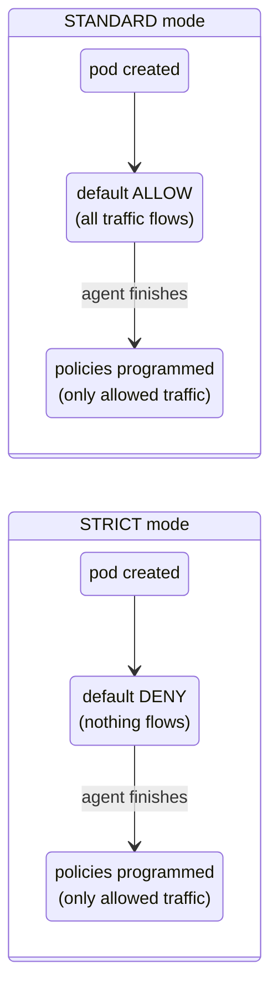

Strict mode is set with an environment variable on the `aws-node` container:

```yaml
env:
  - name: NETWORK_POLICY_ENFORCING_MODE
    value: "strict"
```

**Which to choose?** Standard is easier to adopt: a pod no policy selects behaves exactly as before. Strict is the right end state for high-security clusters, but turn it on only after every namespace has policies (including `kube-system`), or pods will start dark. Apps should also **retry on startup** in either mode, because rules arrive asynchronously.

On **EKS Auto Mode**, the same choice is a field on the `NodeClass`: `networkPolicy: DefaultAllow` or `DefaultDeny`. With `DefaultDeny`, DNS is blocked for every pod on those nodes until a policy allows it.

### 6.5 Seeing what it does

Upstream NetworkPolicy has no logging. The VPC CNI adds **policy decision logs** (off by default):

```bash
aws eks update-addon --cluster-name my-cluster --addon-name vpc-cni \
  --configuration-values '{"enableNetworkPolicy": "true", "nodeAgent": {"enablePolicyEventLogs": "true", "enableCloudWatchLogs": "true"}}'
```

- On the node, decisions land in `/var/log/aws-routed-eni/network-policy-agent.log` as JSON `Flow Info` lines with src/dst IP, ports, protocol and `Verdict` (`ACCEPT` / `DENY`).
- With `enableCloudWatchLogs`, they're shipped to CloudWatch (the node role needs `logs:CreateLogGroup/CreateLogStream/PutLogEvents/DescribeLogGroups`).
- AWS documents that decision logging costs roughly **one extra vCPU** for the agent container. Enable it while rolling out, and reconsider leaving it on everywhere.
- On a node, `sudo /opt/cni/bin/aws-eks-na-cli ebpf progs` lists the loaded eBPF programs. The same tool can dump maps.
- First troubleshooting step for "my policy does nothing": `kubectl get policyendpoints -A`. If there are none for your policy, the controller isn't on or couldn't resolve it.

### 6.6 Gotchas specific to the VPC CNI

1. **The 24-combination limit.** At most **24 unique port/protocol combinations per CIDR** across all policies. Selectors resolve into CIDRs, so a busy policy can hit this. Use port **ranges** (`endPort`) to reduce unique ports.
2. **Service port must equal the container port.** If a Service maps `80 → 8080`, write policies for 8080 *and* keep the Service port equal to it (and use the same name for named ports). AWS lists this as a requirement.
3. **Pods are identified by name prefix.** The agent identifies a pod by namespace + the part of its name **before the last hyphen**. On one node, `db-0` and `db-debug` share a rule set, and rules can linger after one is deleted. Give ad-hoc pods unique prefixes. (A 2026 security advisory was about exactly this class of collision.)
4. **IMDS.** Pods that still use the node's instance role (not IRSA or Pod Identity) talk to `169.254.169.254`. An egress default-deny cuts them off. That's often what you want, but check first.
5. **Allow-only.** Standard NetworkPolicy has no deny, so "everything except X" needs ClusterNetworkPolicy (next section).
6. **Migrating from Calico/Cilium:** remove the old enforcer first, then **replace the nodes**. A plugin that exits suddenly can leave rules behind in the kernel.

### 6.7 Keep the VPC CNI current

The agent is security-critical code, and it gets advisories like any other. In 2026 there were at least two NetworkPolicy-bypass advisories in `aws-network-policy-agent`: **CVE-2026-122266**, fixed in agent 1.3.7 / VPC CNI v1.22.3, and **CVE-2026-86831** (pod identifier collisions), fixed in agent 1.4.0 / VPC CNI **v1.22.4**. Rule of thumb: treat the `vpc-cni` add-on version like a kernel version and upgrade it deliberately and regularly.

### 6.8 Cluster-wide guardrails: EKS ClusterNetworkPolicy

Released December 2025. It's AWS's implementation of the **admin network policy idea** from SIG Network, as its own CRD in the `networking.k8s.aws` group. It exists for the platform team, and it adds what NetworkPolicy lacks: **cluster scope, deny, ordering, and rules namespace owners can't override.**

Evaluation order:

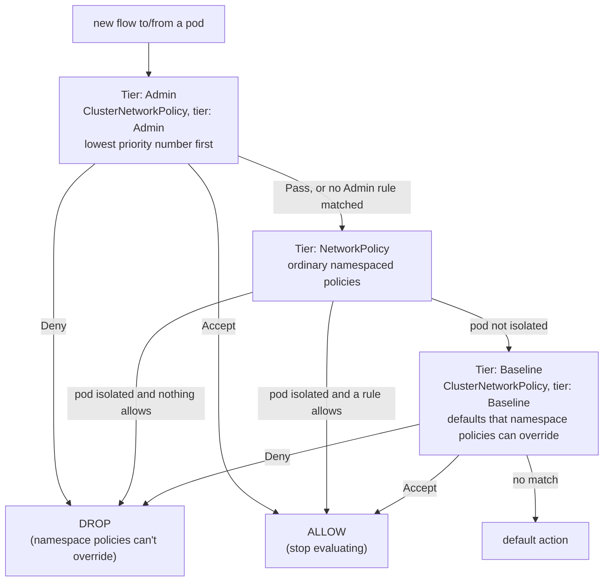

Three actions:

- **Deny**: drop now. In the Admin tier this beats anything a namespace owner writes.
- **Accept**: allow now and stop evaluating.
- **Pass** (Admin only): "the admin tier has no opinion". Skip the remaining Admin rules and let namespace NetworkPolicies decide.

Two guardrails most clusters want:

```yaml
# Nobody may reach EC2 instance metadata (pods should use IRSA / Pod Identity instead)
apiVersion: networking.k8s.aws/v1alpha1
kind: ClusterNetworkPolicy
metadata:
  name: deny-imds
spec:
  tier: Admin
  priority: 10
  subject:
    namespaces:
      matchLabels: {}            # all namespaces
  egress:
    - name: deny-imds
      action: Deny
      to:
        - networks:
            - 169.254.169.254/32
---
# Example from the AWS docs: isolate a sensitive namespace from all others
apiVersion: networking.k8s.aws/v1alpha1
kind: ClusterNetworkPolicy
metadata:
  name: protect-sensitive-workload
spec:
  tier: Admin
  priority: 10
  subject:
    namespaces:
      matchLabels:
        kubernetes.io/metadata.name: earth
  ingress:
    - action: Deny
      from:
        - namespaces:
            matchLabels: {}      # from every namespace
      name: select-all-deny-all
```

Ports use the shape `ports: [ { portNumber: { protocol: UDP, port: 53 } } ]`.

Things to keep straight:

- This is **not** the upstream object. Upstream is `policy.networking.k8s.io/v1alpha2` `ClusterNetworkPolicy`, which uses a `protocols` field for ports. AWS's CRD is `networking.k8s.aws/v1alpha1`, with a similar idea but different fields. Manifests aren't portable between them yet.
- The upstream spec says a ClusterNetworkPolicy **doesn't implicitly isolate** pods. The AWS docs' tables describe the end of evaluation as "default deny (if no policies match)". Before relying on either reading, test what happens to a pod that's selected only by a Baseline policy.
- It's available in all EKS launch modes (standard EC2 nodes and Auto Mode) with VPC CNI ≥ v1.21.1. There's no extra switch beyond enabling network policy.

### 6.9 DNS-based egress: ApplicationNetworkPolicy (Auto Mode only)

`ApplicationNetworkPolicy` is "NetworkPolicy plus `domainNames` in egress rules". The catch: **DNS rules only work on EKS Auto Mode-launched nodes.** On ordinary managed node groups or Karpenter-provisioned EC2 nodes you don't get FQDN rules from AWS. In a mixed cluster they apply only on the Auto Mode nodes.

How it works:

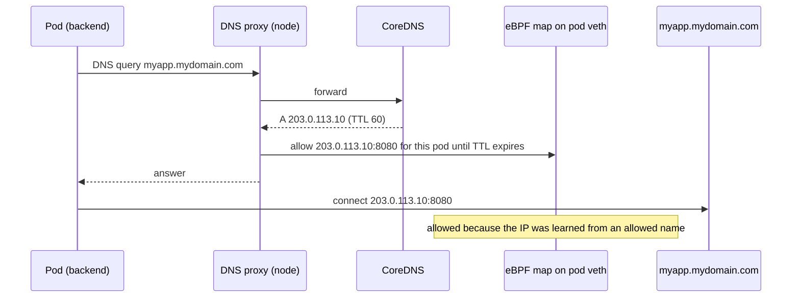

```yaml
apiVersion: networking.k8s.aws/v1alpha1
kind: ApplicationNetworkPolicy
metadata:
  name: my-onprem-app-egress
  namespace: galaxy
spec:
  podSelector:
    matchLabels:
      role: backend
  policyTypes: [Egress]
  egress:
    - to:
        - ipBlock: { cidr: 10.100.0.10/32 }   # DNS server must be allowed explicitly
      ports:
        - { protocol: TCP, port: 53 }
        - { protocol: UDP, port: 53 }
    - to:
        - domainNames:
            - "myapp.mydomain.com"
      ports:
        - { protocol: TCP, port: 8080 }
```

Rules: allow DNS itself, or no name will ever resolve. Don't give an ApplicationNetworkPolicy the same name as a NetworkPolicy in the same namespace. A Route 53 DNS Firewall block still wins over the policy.

### 6.10 EKS Auto Mode in one paragraph

Auto Mode runs the VPC CNI for you and **does not allow alternative CNIs or policy engines**. So on Auto Mode, Cilium and Calico aren't options. You enable the controller with the `amazon-vpc-cni` ConfigMap (`enable-network-policy-controller: "true"`), choose `DefaultAllow`/`DefaultDeny` and `networkPolicyEventLogs: Enabled` on the `NodeClass`, and you get NetworkPolicy, ClusterNetworkPolicy and ApplicationNetworkPolicy (FQDN).

---

## 7. Security groups for pods (not network policy, but often confused with it)

Security groups for pods gives **one pod its own ENI** so it can have its **own EC2 security groups**.

How it works:

- The **VPC resource controller** (part of EKS) attaches a **trunk ENI** to each supported node.
- For each matching pod, it creates a **branch ENI** with your chosen security groups and plumbs it into the pod.
- Pods ask for this through a `SecurityGroupPolicy` CRD that selects pods by labels or service account.
- You enable it with `ENABLE_POD_ENI=true` on `aws-node`, and the cluster role needs `AmazonEKSVPCResourceController`.

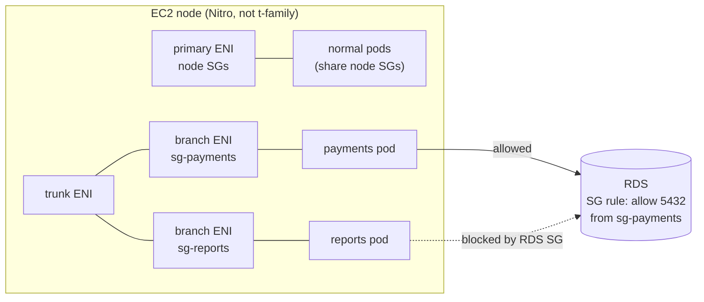

```yaml
apiVersion: vpcresources.k8s.aws/v1beta1
kind: SecurityGroupPolicy
metadata:
  name: payments-db-access
  namespace: payments
spec:
  podSelector:
    matchLabels:
      app: payments
  securityGroups:
    groupIds:
      - sg-0123456789abcdef0   # the SG that the RDS security group trusts
```

**When to use it:** when something *outside* Kubernetes (an RDS instance, ElastiCache, a legacy EC2 service) must allow a specific workload, and you want that rule as an SG-to-SG reference instead of "the whole node subnet".

**Why it doesn't replace network policy:**

| | Security groups for pods | Network policy |
|---|---|---|
| Unit | EC2 security group on a branch ENI | Labels on pod veth |
| Best at | Pod → AWS services (SG references) | Pod ↔ pod inside the cluster |
| Startup cost | Creates an ENI per pod (EC2 API rate limits, slower churn) | Map updates |
| Density | Limited branch ENIs per instance (`vpc.amazonaws.com/pod-eni`) | Unlimited |
| Instance types | Most Nitro families, no `t` family | Any Linux node |
| Fargate | Supported | Not supported |

AWS's own advice is to use both: network policy for in-cluster traffic, security groups for pods for access to AWS services. Two interaction details:

- `POD_SECURITY_GROUP_ENFORCING_MODE`: `strict` (default) sends all of an SG-pod's traffic through its branch ENI, including traffic leaving the VPC (no SNAT, so it needs NAT gateways). `standard` lets traffic leaving the VPC use the primary ENI, and is required for NodeLocal DNSCache and for **Calico** policy on those pods.
- **Calico doesn't enforce policy on SG pods** unless the VPC CNI is ≥ 1.11.0 *and* the enforcing mode is `standard`.

---

## 8. Option B: Cilium on EKS

Part 2 explains Cilium in depth: eBPF data plane, **identity-based** policy, Hubble. Here's what's different on EKS.

### 8.1 The core idea, briefly: identities instead of IPs

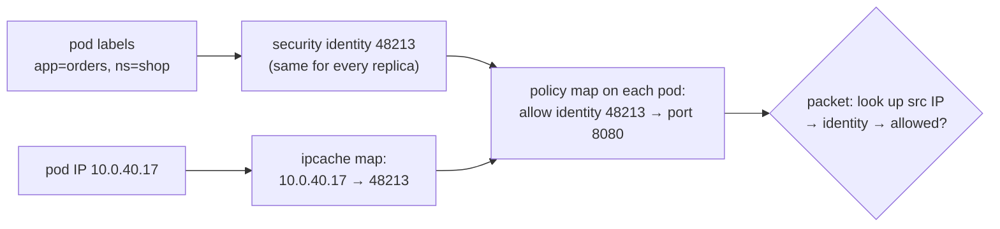

Policy is computed per **identity**, not per pod IP. When a new replica starts, only one ipcache entry changes, not every rule that mentions it. Compare that with the VPC CNI's IP-list `PolicyEndpoint` approach.

### 8.2 Three ways to install Cilium on EKS

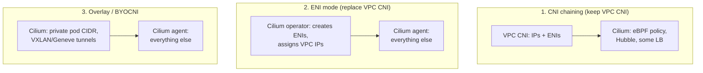

| | 1. Chaining | 2. ENI mode | 3. Overlay |
|---|---|---|---|
| Who assigns pod IPs | VPC CNI | Cilium operator (EC2 API) | Cilium (private range) |
| Pod IPs are VPC IPs | Yes | Yes | **No** (SNAT to node IP when leaving) |
| `aws-node` | Stays | Stays installed but **patched** with a nodeSelector so it never runs | Not used. Flush its iptables chains on existing nodes. |
| Cilium features | **Limited**: L7 policy and IPsec are called out as restricted | Full | Full |
| EKS control plane → pods (webhooks) | Works | Works | **Doesn't**: the API server can't route to overlay IPs. Run webhooks with `hostNetwork` or expose them another way. |
| Security groups for pods | Supported (documented) | No | No |
| IP exhaustion | Same as VPC CNI | Same (supports prefix delegation) | Solved |
| Best for | Trying Cilium policy + Hubble without changing networking | The "full Cilium" choice on EKS | Tight IP space |

Chaining install (from the Cilium docs):

```bash
helm install cilium cilium/cilium --version 1.20.5 \
  --namespace kube-system \
  --set cni.chainingMode=aws-cni \
  --set cni.exclusive=false \
  --set enableIPv4Masquerade=false \
  --set routingMode=native
```

Pods already running when you install the chained config **are not protected** until restarted. Until then, Cilium load-balances to them but enforces no policy for them.

ENI mode install:

```bash
# stop the VPC CNI from scheduling, so the two don't fight over ENIs
kubectl -n kube-system patch daemonset aws-node --type='strategic' \
  -p='{"spec":{"template":{"spec":{"nodeSelector":{"io.cilium/aws-node-enabled":"true"}}}}}'

helm install cilium cilium/cilium --version 1.20.5 --namespace kube-system \
  --set eni.enabled=true
  # optional: --set eni.nodeSpec.firstInterfaceIndex=1 (keep pods off eth0)
```

Also taint new nodes with `node.cilium.io/agent-not-ready=true:NoExecute`, so no pod gets scheduled before Cilium is ready on that node. The Cilium operator needs EC2 permissions (`CreateNetworkInterface`, `AttachNetworkInterface`, `AssignPrivateIpAddresses`, `Describe*`, …).

### 8.3 What you get in policy terms

Cilium enforces standard `NetworkPolicy` and adds its own CRDs:

```yaml
# Cluster-wide: nobody reaches IMDS. A deny rule, so namespace policies can't override it.
apiVersion: cilium.io/v2
kind: CiliumClusterwideNetworkPolicy
metadata:
  name: deny-imds
spec:
  endpointSelector: {}            # all pods
  enableDefaultDeny:
    egress: false                 # don't isolate pods just because this policy selects them
  egressDeny:
    - toCIDR:
        - 169.254.169.254/32
---
# Namespaced: orders may resolve DNS, call one external API by name, and only GET /api/* on inventory
apiVersion: cilium.io/v2
kind: CiliumNetworkPolicy
metadata:
  name: orders-egress
  namespace: shop
spec:
  endpointSelector:
    matchLabels: { app: orders }
  egress:
    - toEndpoints:
        - matchLabels:
            k8s:io.kubernetes.pod.namespace: kube-system
            k8s-app: kube-dns
      toPorts:
        - ports: [ { port: "53", protocol: ANY } ]
          rules:
            dns: [ { matchPattern: "*" } ]     # lets Cilium see DNS answers (needed for toFQDNs)
    - toFQDNs:
        - matchName: api.example.com
      toPorts:
        - ports: [ { port: "443", protocol: TCP } ]
    - toEndpoints:
        - matchLabels: { app: inventory }
      toPorts:
        - ports: [ { port: "8080", protocol: TCP } ]
          rules:
            http: [ { method: GET, path: "/api/.*" } ]   # L7: goes through Envoy
```

Extras over the VPC CNI: **deny rules** anywhere, **FQDN egress on any node** (not just Auto Mode), **L7** (HTTP/gRPC/Kafka/DNS), **entities** (`world`, `kube-apiserver`, `host`), per-pod **audit mode**, and **Hubble** for live flow visibility with drop reasons. Cilium 1.20 also implements upstream ClusterNetworkPolicy behind a flag.

### 8.4 EKS-specific costs of choosing Cilium

- **Support.** AWS says the VPC CNI is the **only** CNI it supports on EC2 nodes. With Cilium, support comes from you or from a vendor (Isovalent is AWS's listed partner).
- **Not available** on Fargate or EKS Auto Mode. For EKS Hybrid Nodes, AWS supports Cilium's core capabilities.
- **You own upgrades** of a component every packet flows through, plus the EKS-side wiring (aws-node patch, taints, IAM).
- L7 policies and FQDN proxying have real CPU and latency costs. Part 2 §7 covers them.

---

## 9. Option C: Calico on EKS

Calico is the oldest widely used network-policy engine, and AWS has documented "VPC CNI + Calico for policy" for years.

### 9.1 Two ways to install Calico on EKS

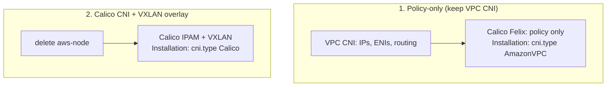

| | 1. Policy-only on VPC CNI | 2. Calico CNI (VXLAN) |
|---|---|---|
| Pod IPs | VPC IPs (VPC CNI) | Private Calico pool, tunneled |
| `aws-node` | Stays. Set `ANNOTATE_POD_IP=true` and give its ClusterRole `patch` on pods. | **Deleted** |
| VPC CNI network policy | **Must stay disabled**, since it conflicts with Calico | n/a |
| Max pods | VPC CNI limits | Set `--max-pods-per-node` yourself, or EKS keeps the ENI-based limit |
| Control plane → pods | Works | **Doesn't**: webhooks need `hostNetwork: true` |
| Security groups for pods | Only with `POD_SECURITY_GROUP_ENFORCING_MODE=standard` | No |

Policy-only, with the Tigera operator (Calico 3.33):

```yaml
apiVersion: operator.tigera.io/v1
kind: Installation
metadata:
  name: default
spec:
  kubernetesProvider: EKS
  cni:
    type: AmazonVPC      # Calico does policy only; VPC CNI keeps doing networking
  calicoNetwork:
    bgp: Disabled
```

### 9.2 Calico's policy model

Calico enforces standard NetworkPolicy and adds `projectcalico.org/v3` objects:

- **`NetworkPolicy`** (namespaced) and **`GlobalNetworkPolicy`** (cluster-wide; can also protect host interfaces).
- An **`order`** field: lower runs first.
- Actions: **Allow**, **Deny**, **Log** (log and continue), **Pass** (skip to the next tier).
- A rich **selector language** (`app == 'orders' && env != 'dev'`, `all()`, `has(label)`), plus `namespaceSelector`, `serviceAccountSelector`, and `nets` for CIDRs.
- **Tiers**: ordered groups of policies. Calico creates `kube-admin` (order 1,000, default action Pass), `default` (order 1,000,000, where ordinary NetworkPolicies live), and `kube-baseline` (order 10,000,000, default action Pass). Upstream `ClusterNetworkPolicy` with `tier: Admin` is mapped into `kube-admin`, and `Baseline` into `kube-baseline`.

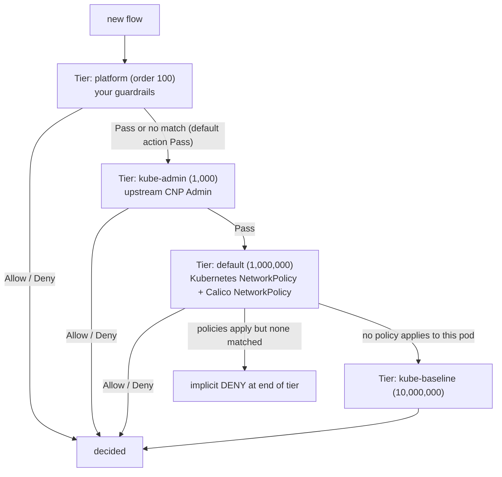

Note the **implicit deny at the end of every tier** that has a policy selecting the pod. A tier must end in Pass (or have default action Pass) to fall through. Getting that wrong is the classic Calico tiers mistake.

A guardrail tier that blocks IMDS, logs attempts, and passes everything else on:

```yaml
apiVersion: projectcalico.org/v3
kind: Tier
metadata:
  name: platform
spec:
  order: 100
  defaultAction: Pass          # unmatched traffic continues to later tiers
---
apiVersion: projectcalico.org/v3
kind: GlobalNetworkPolicy
metadata:
  name: platform.deny-imds     # policies in a non-default tier are named <tier>.<name>
spec:
  tier: platform
  order: 10
  selector: all()
  types: [Egress]
  egress:
    - action: Log
      destination: { nets: [169.254.169.254/32] }
    - action: Deny
      destination: { nets: [169.254.169.254/32] }
    - action: Pass               # everything else: let the next tier decide
```

### 9.3 Data planes and observability

Calico lets you choose the data plane: **iptables** (classic), **nftables** (3.33 adds performance work and an optional flowtable offload), and **eBPF** (needs kernel 5.10+ with BTF; netkit is now the default attach type). On EKS policy-only mode, Calico works alongside the VPC CNI's interfaces.

Observability in open source: **Goldmane** (flow aggregation) and **Whisker** (a flow-log UI) ship with the operator but are still **technology preview** in 3.33. Features like DNS/domain-based policy and richer flow visualization have historically been part of Calico's commercial editions. Check the OSS docs for your version before you plan around them.

### 9.4 EKS-specific costs of choosing Calico

Same as Cilium: AWS doesn't support it (Tigera is the listed partner), there's no Fargate or Auto Mode, and you run and upgrade it yourself. Calico's strengths are a long track record, a very expressive policy language with tiers and ordering, and the ability to protect **host** interfaces with GlobalNetworkPolicy.

---

## 10. Comparing the options

### 10.1 Feature by feature

| | VPC CNI network policy | Calico (policy-only on VPC CNI) | Cilium (chaining) | Cilium (ENI mode) |
|---|---|---|---|---|
| Networking / IPs | VPC CNI | VPC CNI | VPC CNI | Cilium |
| Data plane | eBPF | iptables / nftables / eBPF | eBPF | eBPF |
| Standard NetworkPolicy | ✅ | ✅ | ✅ | ✅ |
| Cluster-wide policy | ✅ AWS ClusterNetworkPolicy | ✅ GlobalNetworkPolicy + tiers, upstream CNP | ✅ CCNP | ✅ CCNP |
| Explicit deny | ✅ via ClusterNetworkPolicy | ✅ | ✅ | ✅ |
| FQDN egress | ⚠️ Auto Mode nodes only | ⚠️ check edition/version | ✅ | ✅ |
| L7 (HTTP/gRPC) rules | ❌ | ⚠️ limited in OSS | ⚠️ limited when chained | ✅ |
| Flow visibility | Decision logs → file/CloudWatch | Goldmane/Whisker (preview) | Hubble | Hubble |
| Startup behavior | standard (allow first) / strict (deny first) | Felix programs on pod start | Holds pod until identity known (after restart) | same |
| Works on Auto Mode | ✅ (only option) | ❌ | ❌ | ❌ |
| Works on Fargate | ❌ (use SG for pods) | ❌ | ❌ | ❌ |
| Supported by AWS | ✅ | Partner | Partner | Partner |
| Ops burden | Lowest (managed add-on) | Medium | Medium | Highest (you own pod networking) |
| Extra cost | None | OSS free / enterprise paid | OSS free / enterprise paid | OSS free / enterprise paid |

### 10.2 How to choose

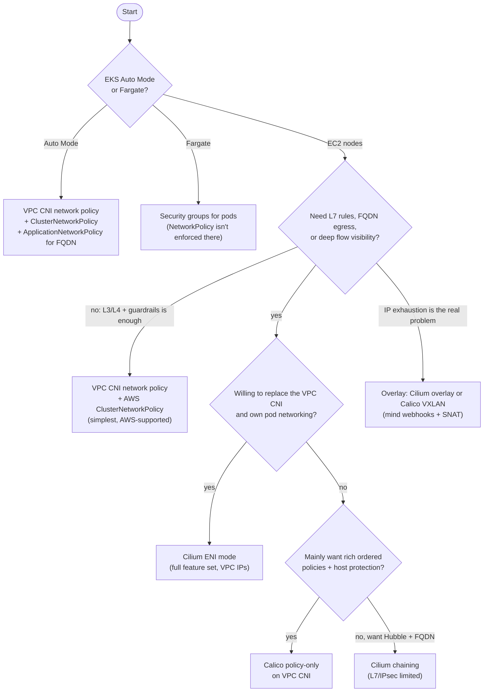

A rough rule: **start with the VPC CNI's native policy unless you have a concrete need it can't meet.** You can express the most important controls with it: default-deny per namespace, DNS allowed, IMDS blocked cluster-wide, sensitive namespaces isolated. It's also the only option that's AWS-supported, free and zero-install. Reach for Cilium when FQDN egress on normal nodes, L7 rules or Hubble-level visibility is a hard requirement. Reach for Calico when you want its tiered policy language and are comfortable running it.

### 10.3 Where upstream is heading

Every engine has its own "cluster-wide, ordered, with deny" CRD today: AWS `ClusterNetworkPolicy` (`networking.k8s.aws`), Cilium CCNP, Calico GlobalNetworkPolicy + tiers. SIG Network's **`ClusterNetworkPolicy` (`policy.networking.k8s.io/v1alpha2`)** is the attempt to standardize them. Calico 3.32+ and Cilium 1.20 (behind a flag) implement it, and it's heading for beta. AWS's CRD has the same shape (Admin/Baseline tiers, Accept/Deny/Pass, priority). Expect convergence, and keep guardrail policies few and well-commented so a later migration is easy.

---

## 11. From learning to implementing: what to know before you start

This is the generic order that works on any EKS cluster, whichever engine you pick.

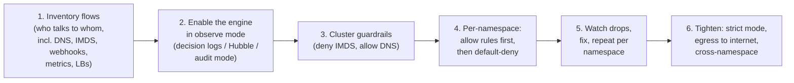

The flows that break first on EKS, and why:

| What breaks | Why | Fix |
|---|---|---|
| **DNS** | Egress default-deny blocks UDP **and** TCP 53 to CoreDNS. In strict mode CoreDNS's own ingress is blocked too. | Allow egress to `kube-dns` on 53/UDP+TCP. Allow ingress to CoreDNS. With NodeLocal DNSCache, allow its address too. |
| **Admission webhooks** | The EKS API server calls webhook pods from control-plane ENIs in your VPC subnets, not from a pod. | Allow ingress to the webhook port from the cluster's subnets / VPC CIDR. (Overlay CNIs: run webhooks with `hostNetwork`.) |
| **Load balancer traffic** (AWS Load Balancer Controller, `target-type: ip`) | ALB/NLB sends straight to pod IPs from the LB's own IPs in your subnets. With NLB client-IP preservation, the source is the real client. | Allow ingress on the target port from the LB subnets' CIDRs, or from `0.0.0.0/0` when client IP is preserved. |
| **Metrics scraping** | Prometheus/agents in a monitoring namespace get blocked by default-deny ingress. | One allow rule per namespace (or a Baseline/Admin Accept) from the monitoring namespace to metrics ports. |
| **IMDS** | Pods on the node instance role lose credentials. | Move them to IRSA / Pod Identity, then deny IMDS cluster-wide. |
| **AWS APIs / external services** | Egress default-deny blocks the public AWS endpoints. | VPC endpoints (private IPs in your VPC) plus an `ipBlock`, or FQDN rules where supported. |
| **Service port ≠ container port** (VPC CNI) | Documented VPC CNI requirement | Align the ports, or test carefully |
| **Kubelet probes** | Normally fine: node-to-pod is allowed | Nothing to do, but don't be surprised that probes still pass while real traffic fails |

Debugging a "connection timed out" after policies go in:

1. `kubectl get networkpolicy -n <ns>` and `kubectl describe` to see which policies select the pod and what was parsed.
2. VPC CNI: `kubectl get policyendpoints -n <ns>`, then the decision log on the node (`/var/log/aws-routed-eni/network-policy-agent.log`, `Verdict: DENY`).
3. Cilium: `hubble observe --verdict DROPPED --namespace <ns>`. Calico: Whisker / flow logs, or `Log` actions.
4. Check **both ends**: the source's egress and the destination's ingress (rule 4).
5. Check DNS separately: `nslookup` failing looks like "everything is down".

---

## 12. Summary

- A Kubernetes cluster is a **flat network**. On EKS, pods even have **real VPC IPs**, but AWS's IP-and-ENI-based controls can't tell pods apart, don't see same-node traffic, and don't understand labels.
- **NetworkPolicy** is a firewall written in labels, enforced by the CNI at each pod's veth. It's allow-only, namespaced, per-direction, and the union of all matching policies. Kubernetes stores it but **doesn't enforce it**.
- On EKS the **VPC CNI** can enforce it with eBPF: a **controller in the control plane** resolves selectors into `PolicyEndpoint` IP lists, and an **agent in `aws-node`** programs eBPF maps. Choose **standard** (allow until programmed) or **strict** (deny until programmed). Since Dec 2025 it adds AWS **ClusterNetworkPolicy** (Admin/Baseline tiers, Accept/Deny/Pass) everywhere, and **ApplicationNetworkPolicy** (FQDN) on Auto Mode nodes.
- **Security groups for pods** gives one pod its own ENI and EC2 SGs. Use it for pod→AWS-service access. It complements network policy and doesn't replace it.
- **Cilium** (chaining / ENI / overlay) brings identity-based eBPF policy, deny, FQDN, L7 and Hubble, at the cost of running a non-AWS-supported data plane.
- **Calico** (policy-only / VXLAN) brings tiers, ordering, Deny/Log/Pass and host protection, with a choice of data planes. Same support trade-off.
- Start simple (VPC CNI native + a few cluster guardrails), roll out **observe → allow → deny**, namespace by namespace, and expect DNS, webhooks, load balancers and IMDS to be the first things that break.

---

### Sources

- Kubernetes: [Network Policies](https://kubernetes.io/docs/concepts/services-networking/network-policies/) (as of v1.37)
- SIG Network network-policy-api: [API overview](https://network-policy-api.sigs.k8s.io/api-overview/), [v1alpha2: ClusterNetworkPolicy replaces ANP/BANP](https://network-policy-api.sigs.k8s.io/blog/2025/10/09/api-update-for-v1alpha2-clusternetworkpolicy-replaces-adminnetworkpolicy-and-baselineadminnetworkpolicy/)
- AWS EKS user guide: [Limit pod traffic with Kubernetes network policies](https://docs.aws.amazon.com/eks/latest/userguide/cni-network-policy.html), [Configure network policies](https://docs.aws.amazon.com/eks/latest/userguide/cni-network-policy-configure.html), [Troubleshooting network policies](https://docs.aws.amazon.com/eks/latest/userguide/network-policies-troubleshooting.html), [Network policies with EKS Auto Mode](https://docs.aws.amazon.com/eks/latest/userguide/auto-net-pol.html), [Security groups for pods](https://docs.aws.amazon.com/eks/latest/userguide/security-groups-for-pods.html), [Alternate CNI plugins](https://docs.aws.amazon.com/eks/latest/userguide/alternate-cni-plugins.html)
- AWS announcements: [VPC CNI supports NetworkPolicy (Aug 2023)](https://aws.amazon.com/about-aws/whats-new/2023/08/amazon-vpc-cni-kubernetes-networkpolicy-enforcement/), [Amazon VPC CNI now supports Kubernetes Network Policies (blog)](https://aws.amazon.com/blogs/containers/amazon-vpc-cni-now-supports-kubernetes-network-policies/), [EKS enhanced network security policies (Dec 15, 2025)](https://aws.amazon.com/about-aws/whats-new/2025/12/amazon-eks-enhanced-network-security-policies), [EKS introduces enhanced network policy capabilities (blog)](https://aws.amazon.com/blogs/containers/amazon-eks-introduces-enhanced-network-policy-capabilities)
- Advisories: [CVE-2026-122266 (Rapid7)](https://www.rapid7.com/db/vulnerabilities/cve-2026-122266/), [CVE-2026-86831 (SentinelOne)](https://www.sentinelone.com/vulnerability-database/cve-2026-86831/)
- Cilium (1.20): [AWS VPC CNI chaining](https://docs.cilium.io/en/stable/installation/cni-chaining-aws-cni/), [ENI IPAM](https://docs.cilium.io/en/stable/network/concepts/ipam/eni/), [Helm install (EKS sections)](https://docs.cilium.io/en/stable/installation/k8s-install-helm/), [releases](https://github.com/cilium/cilium/releases), blog posts on [ENI mode](https://cilium.io/blog/2025/06/19/eks-eni-install) and [overlay / chaining](https://cilium.io/blog/2025/07/08/byonci-overlay-install)
- Calico (3.33): [Calico on EKS](https://docs.tigera.io/calico/latest/getting-started/kubernetes/managed-public-cloud/eks), [Calico network policy](https://docs.tigera.io/calico/latest/network-policy/get-started/calico-policy/calico-network-policy), [Tiered policy](https://docs.tigera.io/calico/latest/network-policy/policy-tiers/tiered-policy), [Release notes](https://docs.tigera.io/calico/latest/release-notes/)
- Earlier parts of this series: [Kubernetes Networking](../kubernetes-networking/), [Kubernetes Network Policies, eBPF and Cilium](../kubernetes-network-policies/)
